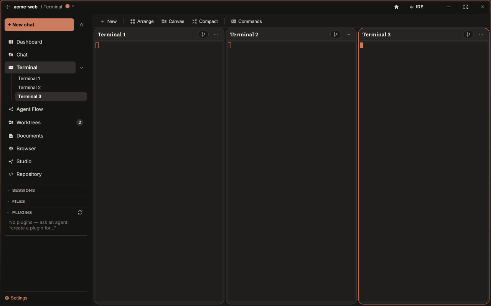
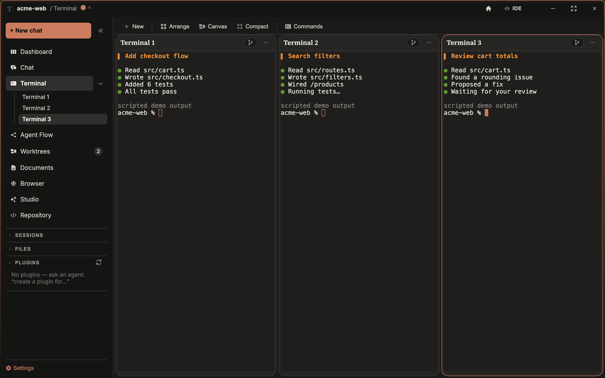
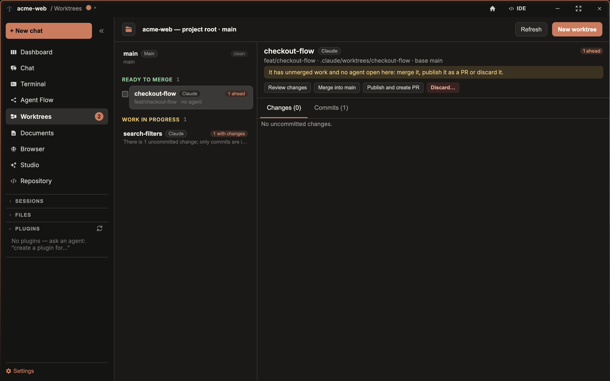
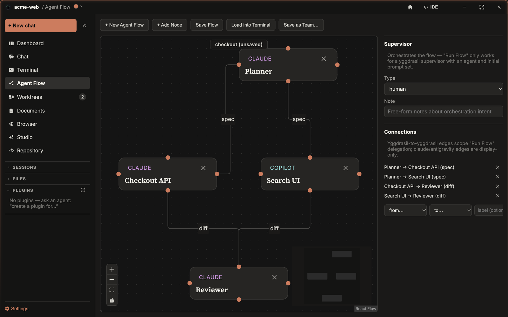

# Yggdrasil

**A desktop ADE to run coding agents side by side: terminals, worktrees and workflows.**

[](https://github.com/mauriciorossdev/yggdrasilOS/actions/workflows/test.yml)
[](https://github.com/mauriciorossdev/yggdrasilOS/releases/latest)
[](LICENSE)



<sub>The demo project and the terminal output in these captures are scripted.</sub>

Yggdrasil is an agentic development environment. It runs the agent CLIs you already use — Claude Code, GitHub Copilot
CLI, Antigravity and omp — next to each other, and gives you one place to see what each one is doing, keep their work
apart and review it before it lands.

> **Status: pre-1.0.** APIs and file formats can still change. Issues and pull requests are welcome — see
> [CONTRIBUTING.md](CONTRIBUTING.md).

## Download

Installers for Windows, macOS (Apple silicon) and Linux are on the
[releases page](https://github.com/mauriciorossdev/yggdrasilOS/releases/latest). Install the agent CLIs you want to use
separately; Yggdrasil detects them.

The installers are not code signed yet. On Windows, choose **More info → Run anyway**. On macOS, open
**System Settings → Privacy & Security** and click **Open Anyway**.

## What you can do

### Run agents in parallel

Open as many terminal panes as you need and arrange them in a grid or on a canvas. Link two projects and an agent in
one can read or write the other's panes, asking you first. With
Claude Code, the app tells you which pane is waiting for you and which one has finished, and you can queue the next
message while it is still busy.



### Keep their work apart with git worktrees

Give each task its own worktree and branch. See what is ready to merge and what is still in progress, then merge,
publish as a pull request or discard. Comments you leave on a diff can be sent back to the agent as a prompt.



### Describe a team, then launch it

Agent Flow is a canvas where you lay out agents, their roles and the CLI each one runs, and load them all into
terminals at once. Connections between external CLIs document the flow; delegation along a connection is enforced only
between Yggdrasil's own agents. Workflows run tasks on a schedule.



### Organic Driven Development

The Claude Code agents you run in a project get a short guide on how to work, with as much process as the task needs.
Small work they just do. Larger work starts with a feature doc in `notes/`: your request quoted, acceptance criteria,
tasks and a log. A task is ticked only with observed proof, helpers are spawned only for a stated reason, parallel
workers get their own worktrees, and you do the merging.

### And the rest of the workbench

- **Documents** — a notes folder that you and your agents both read and write.
- **Repository** — branches, history, diffs and commits.
- **Browser** and **file viewer** — including 3D models and audio.
- **Studio** — describe a plugin or a widget and have an agent build it, with a live preview.
- **Dashboard** — your own widgets, with per-domain network permission.
- **Chat** — with Anthropic, Ollama or any OpenAI-compatible API.
- **Phone** — a Flutter app ([`mobile/app`](mobile/app/README.md)) that talks to your desktop.

## Run from source

Requirements: Node >= 22 and pnpm.

```bash
pnpm install
pnpm build
pnpm desktop     # the desktop app
pnpm test        # unit, integration and end-to-end tests with mock providers
```

`pnpm test:live` runs against Ollama Cloud and needs `OLLAMA_API_KEY`.

## Under the desktop app

The app sits on a platform you can also use without it:

- **Gateway** — a WebSocket RPC bus that connects channels (terminal, HTTP, Discord, Slack, Telegram), agent
  harnesses, tools and LLM providers.
- **Plugin system** — channels, tools, harnesses and providers are plugins loaded from `extensions/`, without modifying
  the core.
- **CLI** — `init`, `run`, `tui`, `gateway` and plugin scaffolding. The packages are not published to npm yet, so run
  it from the repository:

```bash
node packages/cli/dist/index.js tui
node packages/cli/dist/index.js create-plugin my-tool --kind tool
```

See [ARCHITECTURE.md](ARCHITECTURE.md) for how the pieces fit together.

## Bring your own credentials

Nothing in this repository ships with secrets or a hosted backend:

- **LLM providers** — set `OLLAMA_API_KEY`, `OPENAI_API_KEY` and so on ([provider config](docs/provider-config.md)).
- **GitHub connector** — works out of the box: it ships the public Client ID of Yggdrasil's GitHub OAuth App (Device
  Flow, no client secret; each user authorizes with their own account and the token stays on their machine). To use
  your own OAuth App instead, set `GITHUB_OAUTH_CLIENT_ID` (with "Enable Device Flow" checked).
- **Google connector** — create your own OAuth app and set `GOOGLE_OAUTH_CLIENT_ID` / `GOOGLE_OAUTH_CLIENT_SECRET`.
- **Phone link** — run your own link server to reach your desktops from any network ([guide](deploy/README.md)).
- **Sync** — self-host `packages/sync-server` and enter its URL in the desktop app's settings.
- **Mobile push** — add your own Firebase config, see [`mobile/app/README.md`](mobile/app/README.md).
- **Desktop auto-update** — off by default; set `YGGDRASIL_UPDATE_URL` to a feed you host.

## Docs

See [`docs/`](docs/README.md) and the [roadmap](docs/roadmap.md). Part of the documentation is written in Spanish.

## Contributing and license

See [CONTRIBUTING.md](CONTRIBUTING.md), [SECURITY.md](SECURITY.md) and the [Code of Conduct](CODE_OF_CONDUCT.md).
Released under the [MIT License](LICENSE). Third-party notices: [THIRD_PARTY_NOTICES.md](THIRD_PARTY_NOTICES.md).
Voice features download third-party models at runtime (Whisper, Piper voices); check their individual licenses before
redistributing builds that bundle them.
