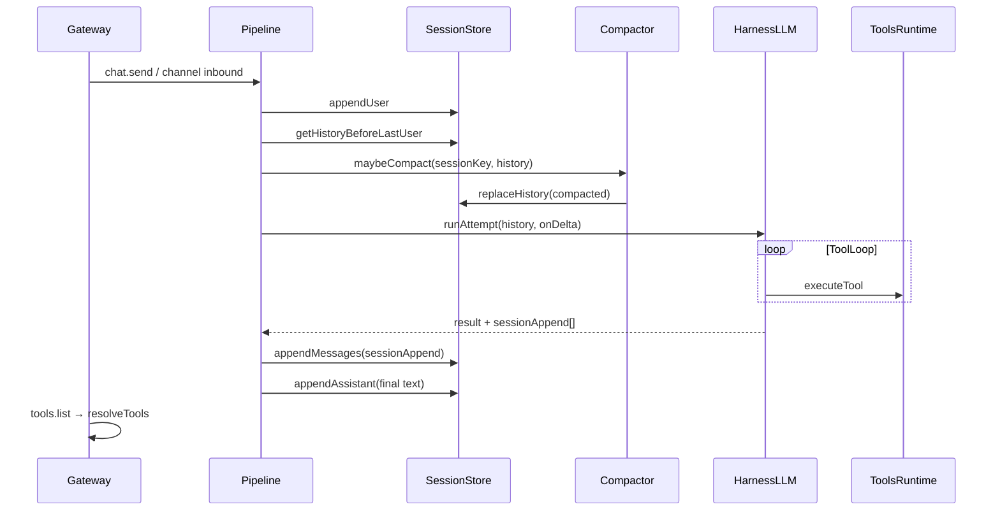
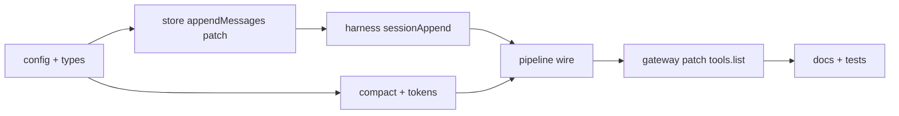

# Iteración 4: Memoria, sesiones y observabilidad

## Objetivo

Hacer conversaciones **largas y debuggables**: compaction automática del historial, sesiones editables vía gateway, visibilidad de tools sin pasar por el LLM, y persistencia de intercambios tool-call en disco.

**Duración sugerida:** 2–3 días  
**Depende de:** Iteración 3 ✅

**Criterios de éxito:**
1. Sesión con 100+ turnos sigue respondiendo (compaction automática antes del límite duro)
2. `tools.list` devuelve `my-tool_echo`, `datetime`, `echo`, etc. con name/description/parameters
3. `sessions.patch` persiste `title`, `metadata`, `agentId` en disco
4. Tras un tool call, `sessions.get` muestra assistant+tool messages (o un bloque compactado que los resume)
5. Tests existentes (29) en verde + ≥6 tests nuevos

**Fuera de alcance:** RAG/vector DB, compaction multi-agente, UI web de sesiones, renombrar repo, publicación npm.

---

## Estado actual (gaps)

| Área | Hoy | Gap |
|------|-----|-----|
| Sesiones | `truncateMessages` por `maxMessages: 50` | Corta sin resumir; pierde contexto abruptamente |
| `getHistory` | Solo `{ role, content }` | Pierde `tool_calls`, `tool_call_id`, `name` |
| Tool loop | Mensajes tool en memoria del harness | Solo `appendAssistant(text)` al final en pipeline |
| `sessions.patch` | Stub `{ patched: true }` | [`packages/gateway/src/methods.ts`](packages/gateway/src/methods.ts) |
| Tools | Solo vía chat | Sin RPC `tools.list` |
| Límites | Conteo de mensajes | Sin estimación de tokens |
| `SessionRecord` | `metadata?` en tipo | No se lee/escribe en store ni patch |
| `health.version` | `"0.2.0"` fijo | Desalineado con plugin API `0.3.0` |

Referencias actuales:

- [`packages/sessions/src/store.ts`](packages/sessions/src/store.ts) — `appendUser` / `appendAssistant` planos
- [`packages/pipeline/src/turn-kernel.ts`](packages/pipeline/src/turn-kernel.ts) — una sola línea assistant al cerrar turn
- [`packages/harness-llm/src/tool-loop.ts`](packages/harness-llm/src/tool-loop.ts) — acumula `messages[]` internamente, no los expone
- [`packages/sessions/src/types.ts`](packages/sessions/src/types.ts) — `SessionMessage extends ChatMessage`

---

## Arquitectura objetivo



---

## Fase A — Config y tipos de sesión

**Archivos:** [`packages/config/src/index.ts`](packages/config/src/index.ts), [`packages/sessions/src/types.ts`](packages/sessions/src/types.ts)

Extender `SessionsConfig`:

```typescript
export type SessionsConfig = {
  dir?: string;
  maxMessages?: number;           // default 50 — límite duro post-compaction
  maxTokens?: number;             // default undefined; si set, recorte preventivo
  compactThreshold?: number;      // default 40 — disparar compaction antes de maxMessages
  compactionPolicy?: "truncate" | "summarize";  // default "summarize"
};
```

Extender `SessionRecord`:

```typescript
export type SessionRecord = {
  sessionKey: string;
  title?: string;
  agentId?: string;
  messages: SessionMessage[];
  createdAt: number;
  updatedAt: number;
  metadata?: Record<string, unknown>;
  compaction?: {
    lastCompactedAt?: number;
    summarizedThroughIndex?: number;
  };
};
```

Extender `SessionSummary` con `title?`, `agentId?`.

Actualizar [`yggdrasil.config.json`](yggdrasil.config.json) ejemplo:

```json
"sessions": {
  "maxMessages": 50,
  "compactThreshold": 40,
  "compactionPolicy": "summarize",
  "maxTokens": 12000
}
```

---

## Fase B — Persistencia de tool turns

### B.1 — SDK: mensajes a persistir

**Archivo:** [`packages/sdk/src/harness.ts`](packages/sdk/src/harness.ts)

```typescript
export type HarnessAttemptResult = {
  // ...existente
  sessionAppend?: ChatMessage[];  // mensajes intermedios del tool loop (assistant+tool)
};
```

### B.2 — Harness LLM expone mensajes del loop

**Archivo:** [`packages/harness-llm/src/tool-loop.ts`](packages/harness-llm/src/tool-loop.ts)

Durante el loop, acumular en `sessionAppend` cada:
- assistant message con `tool_calls`
- tool message con `tool_call_id` + `content`

No incluir el user message actual (ya lo appendea el pipeline).

Retornar `sessionAppend` en `HarnessAttemptResult` junto al texto final.

### B.3 — SessionStore: append rico

**Archivo:** [`packages/sessions/src/store.ts`](packages/sessions/src/store.ts)

Nuevos métodos:

```typescript
async appendMessages(sessionKey: string, messages: ChatMessage[]): Promise<void>
async patch(sessionKey: string, patch: SessionPatch): Promise<SessionRecord>
async replaceMessages(sessionKey: string, messages: SessionMessage[]): Promise<void>
```

`getHistory` / `getHistoryBeforeLastUser` deben mapear **todos** los campos de `ChatMessage` (`tool_calls`, `tool_call_id`, `name`), no solo `role`+`content`.

### B.4 — Pipeline wiring

**Archivo:** [`packages/pipeline/src/turn-kernel.ts`](packages/pipeline/src/turn-kernel.ts)

Tras `runAttempt`:

```typescript
if (result.sessionAppend?.length) {
  await this.sessionStore.appendMessages(sessionKey, result.sessionAppend);
}
await this.sessionStore.appendAssistant(sessionKey, result.text);
```

Orden en disco: `…history, user, [tool turns], assistant final`.

---

## Fase C — Compaction

**Nuevo módulo:** `packages/sessions/src/compact.ts`

| Función | Rol |
|---------|-----|
| `shouldCompact(count, config)` | `count >= compactThreshold` |
| `compactTruncate(messages, keep)` | Mantener últimos N mensajes (fallback) |
| `compactSummarize(messages, options)` | Llamar provider con prompt fijo; reemplazar bloque antiguo por 1 system/user summary |

**Política `summarize` (MVP):**
1. Tomar mensajes `[0 .. threshold)` (excluyendo los últimos `keepRecent` = 10)
2. Si no hay API key → fallback a `truncate`
3. Prompt: *"Resume esta conversación en ≤200 palabras preservando hechos y decisiones"*
4. Insertar como `{ role: "system", content: "[Resumen previo] …" }` al inicio
5. Conservar mensajes recientes intactos (incluyendo tool messages)
6. Actualizar `record.compaction.summarizedThroughIndex`

**Hook en pipeline** (antes de `runAttempt`):

```typescript
import { maybeCompactSession } from "@yggdrasil/sessions";

const history = await maybeCompactSession({
  sessionKey,
  store: this.sessionStore,
  config: this.options.config,
});
```

`maybeCompactSession` recibe provider opcional vía `getProvider` + config del agente para el summarize.

**Config en harness** (opcional, iter 4 ligero):

```typescript
harness?: {
  // ...existente
  compactBeforeTurn?: boolean;  // default true
};
```

---

## Fase D — Estimación de tokens

**Nuevo módulo:** `packages/sessions/src/tokens.ts`

```typescript
export function estimateMessageTokens(msg: ChatMessage): number
export function estimateHistoryTokens(messages: ChatMessage[]): number
export function trimHistoryToTokenBudget(messages: ChatMessage[], maxTokens: number): ChatMessage[]
```

Heurística MVP: `Math.ceil(text.length / 4)` por mensaje (+ overhead fijo por tool_calls).

Invocar en pipeline **después** de compaction y **antes** de `runAttempt` si `sessions.maxTokens` está definido.

---

## Fase E — Gateway: `sessions.patch` + `tools.list`

**Archivo:** [`packages/gateway/src/methods.ts`](packages/gateway/src/methods.ts)

### `sessions.patch`

```typescript
// params: { sessionKey, title?, metadata?, agentId? }
registerCoreMethod("sessions.patch", async (params, ctx) => {
  const sessionKey = String(params.sessionKey ?? "");
  const store = ctx.sessionStore;
  if (!store) throw new Error("session store unavailable");
  const session = await store.patch(sessionKey, {
    title: params.title as string | undefined,
    metadata: params.metadata as Record<string, unknown> | undefined,
    agentId: params.agentId as string | undefined,
  });
  return { session };
});
```

### `tools.list`

```typescript
import { resolveTools, listTools } from "@yggdrasil/tools-runtime";

registerCoreMethod("tools.list", async (_params, ctx) => {
  await resolveTools({ sessionKey: "gateway", config: ctx.config });
  const tools = listTools().map((t) => ({
    name: t.name,
    description: t.description,
    parameters: t.parameters,
  }));
  return { tools };
});
```

### `health`

```typescript
version: "0.4.0",
pluginApi: CURRENT_PLUGIN_API_VERSION,  // desde @yggdrasil/sdk
```

---

## Fase F — Deuda técnica + docs

| Item | Acción |
|------|--------|
| README raíz | Tools, `create-plugin`, link a `docs/sessions.md` |
| `docs/sessions.md` | Compaction, patch, tools.list, formato historial con tools |
| Manifiestos core | `compat.pluginApi` → `>=0.3.0` en packages/*/yggdrasil.plugin.json |
| Convención tools | Nota en `docs/creating-plugins.md`: preferir `snake_case` |
| Roadmap | Marcar iter 4 como en progreso / completada al cerrar |

---

## Fase G — Tests

| Archivo | Qué prueba |
|---------|------------|
| `packages/sessions/src/compact.test.ts` | truncate + summarize mock |
| `packages/sessions/src/tokens.test.ts` | estimación y trim |
| `packages/sessions/src/store.test.ts` | appendMessages con tool_calls, patch |
| `packages/harness-llm/src/tool-loop.test.ts` | retorna `sessionAppend` |
| `test/tools-gateway.test.ts` | `tools.list` vía invokeGatewayMethod |
| `test/sessions-compaction.test.ts` | sesión larga → compaction reduce count |

Mantener 29 tests existentes en verde.

---

## Orden de implementación



1. Config + `SessionRecord` extendido
2. `SessionStore.appendMessages`, `patch`, `getHistory` completo
3. `HarnessAttemptResult.sessionAppend` + tool-loop
4. Pipeline: persist tool turns + hook compaction/tokens
5. `compact.ts` + `tokens.ts`
6. Gateway: `sessions.patch`, `tools.list`, `health` 0.4.0
7. Docs + tests

---

## Archivos clave a tocar

| Archivo | Cambio |
|---------|--------|
| [`packages/config/src/index.ts`](packages/config/src/index.ts) | `SessionsConfig` extendido |
| [`packages/sessions/src/types.ts`](packages/sessions/src/types.ts) | title, agentId, compaction |
| [`packages/sessions/src/store.ts`](packages/sessions/src/store.ts) | appendMessages, patch, replaceMessages |
| [`packages/sessions/src/compact.ts`](packages/sessions/src/compact.ts) | **nuevo** |
| [`packages/sessions/src/tokens.ts`](packages/sessions/src/tokens.ts) | **nuevo** |
| [`packages/sessions/src/index.ts`](packages/sessions/src/index.ts) | exports |
| [`packages/sdk/src/harness.ts`](packages/sdk/src/harness.ts) | `sessionAppend?` |
| [`packages/harness-llm/src/tool-loop.ts`](packages/harness-llm/src/tool-loop.ts) | acumular y retornar sessionAppend |
| [`packages/pipeline/src/turn-kernel.ts`](packages/pipeline/src/turn-kernel.ts) | persist + compact hook |
| [`packages/gateway/src/methods.ts`](packages/gateway/src/methods.ts) | patch, tools.list, health |
| [`yggdrasil.config.json`](yggdrasil.config.json) | sessions.compactThreshold |
| [`docs/sessions.md`](docs/sessions.md) | **nuevo** |
| [`README.md`](README.md) | actualizar |

---

## Demo manual esperada

```bash
pnpm build
node packages/cli/dist/index.js gateway
```

**tools.list** (WebSocket o script):

```json
{ "id": 1, "method": "tools.list", "params": {} }
```

→ `{ "tools": [{ "name": "my-tool_echo", ... }, { "name": "datetime", ... }] }`

**sessions.patch:**

```json
{
  "id": 2,
  "method": "sessions.patch",
  "params": {
    "sessionKey": "tui:default:local-user",
    "title": "Pruebas tools",
    "metadata": { "topic": "demo" }
  }
}
```

**Tool persistence:**

```bash
export OLLAMA_API_KEY=...
node packages/cli/dist/index.js tui
> usa my-tool_echo con message "hola"
```

Luego `sessions.get` → historial incluye assistant con `tool_calls` + tool result.

**Compaction:**

Script de test o TUI con 45+ mensajes → antes del turn 41, historial compactado; respuesta LLM sin error de contexto.

---

## Riesgos y mitigaciones

| Riesgo | Mitigación |
|--------|------------|
| Summarize requiere API key extra | Fallback a `truncate` si no hay key |
| Tool messages inflan disco | compaction resume bloques antiguos incluyendo tools |
| Ollama rechaza historial tool | Reusar serialización OpenAI ya corregida en iter 3 |
| `sessionAppend` duplica assistant final | Solo append intermedios; final vía `appendAssistant` |

---

## Referencias

- Roadmap maestro: [`docs/roadmap-iteraciones.md`](../roadmap-iteraciones.md)
- Iteración 3 (tools): `yggdrasil_iteración_3`
- Plugin API: `CURRENT_PLUGIN_API_VERSION = "0.3.0"` en [`packages/sdk/src/manifest.ts`](packages/sdk/src/manifest.ts)
