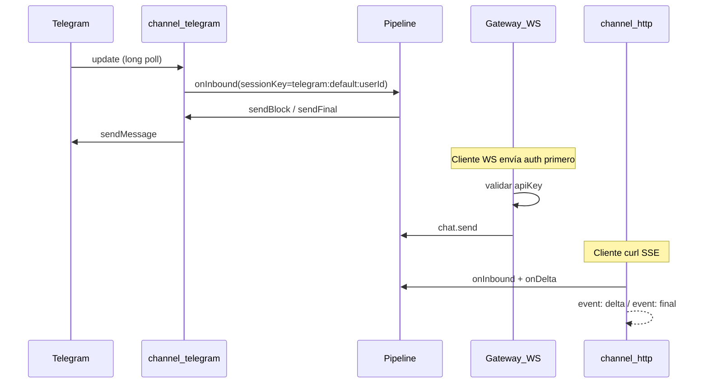
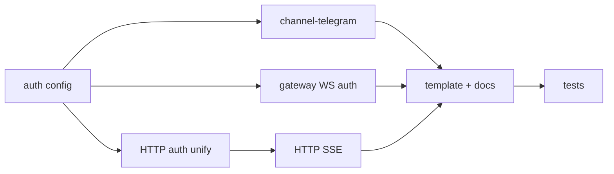

# Iteración 5: Canales externos + seguridad

## Objetivo

Que Yggdrasil viva **fuera de la terminal**: primer canal de mensajería real (Telegram), autenticación en gateway y HTTP, y streaming SSE opcional en el canal HTTP.

**Duración sugerida:** 3–4 días  
**Depende de:** Iteración 4 (recomendado; no bloqueante si iter 4 no está lista)

**Criterios de éxito:**
1. Mensaje en Telegram → respuesta del agente (con tools si el LLM las invoca) para el mismo `sessionKey` que usaría `telegram:default:<userId>`
2. Gateway WebSocket y HTTP sin API key configurada correctamente → `401` cuando `auth` está habilitado
3. `curl -N -H 'Accept: text/event-stream'` en `/inbound` recibe eventos `delta` y `final`
4. `extensions/channel-telegram` carga por discovery; **cero cambios** en `packages/cli/src/index.ts`
5. Tests existentes en verde + ≥5 tests nuevos

**Fuera de alcance:** multi-cuenta Telegram por agente, billing/cuotas, app móvil, cliente web completo, Discord/Slack (solo Telegram en MVP).

---

## Estado actual (gaps)

| Área | Hoy | Gap |
|------|-----|-----|
| Canales | TUI + HTTP | Sin Telegram/Discord/Slack |
| HTTP auth | `accounts.default.token` opcional por cuenta | Sin config global `auth`; sin auth en gateway |
| Gateway WS | Abierto en `127.0.0.1` | Cualquier cliente puede llamar `chat.send` |
| HTTP streaming | Respuesta JSON al final | Sin SSE (`Accept: text/event-stream`) |
| HTTP outbound | Solo `sendFinal` | No propaga `sendBlock` para SSE |
| Sesión externa | `buildSessionKey` manual en body | Sin convención documentada para Telegram |
| Plantilla channel | Console.log stub | Sin ejemplo webhook/long-poll |

Referencias actuales:

- [`packages/channel-http/src/channel.ts`](packages/channel-http/src/channel.ts) — auth por `Bearer` en cuenta; sync JSON reply
- [`packages/gateway/src/server.ts`](packages/gateway/src/server.ts) — WS sin auth
- [`packages/gateway/src/channel-manager.ts`](packages/gateway/src/channel-manager.ts) — ya propaga `onDelta` → `sendBlock` en TUI
- [`packages/cli/templates/channel/src/index.ts`](packages/cli/templates/channel/src/index.ts) — plantilla mínima

**Nota:** HTTP ya soporta `Authorization: Bearer <token>` si `channels.http.accounts.default.token` está set. Iteración 5 **unifica** esto bajo `auth` global sin romper compatibilidad.

---

## Arquitectura objetivo



---

## Fase A — Config y auth unificada

**Archivos:** [`packages/config/src/index.ts`](packages/config/src/index.ts), nuevo `packages/config/src/auth.ts`

```typescript
export type AuthConfig = {
  gateway?: {
    apiKey?: string;
    required?: boolean;  // default false en dev, true si apiKey set
  };
  http?: {
    apiKey?: string;
  };
};

export type YggdrasilConfig = {
  // ...existente
  auth?: AuthConfig;
};
```

Resolver keys con prioridad:

1. `config.auth.gateway.apiKey` / `config.auth.http.apiKey`
2. `process.env.YGGDRASIL_API_KEY` (gateway + http compartido)
3. Legacy: `channels.http.accounts.*.token`

```typescript
export function resolveGatewayApiKey(config: YggdrasilConfig): string | undefined
export function resolveHttpApiKey(config: YggdrasilConfig, accountId?: string): string | undefined
export function isGatewayAuthRequired(config: YggdrasilConfig): boolean
```

Ejemplo [`yggdrasil.config.json`](yggdrasil.config.json):

```json
{
  "auth": {
    "gateway": { "apiKey": "${YGGDRASIL_API_KEY}", "required": true },
    "http": { "apiKey": "${YGGDRASIL_API_KEY}" }
  },
  "channels": {
    "telegram": {
      "enabled": true,
      "accounts": {
        "default": { "botToken": "${TELEGRAM_BOT_TOKEN}" }
      }
    }
  }
}
```

*(MVP: sustituir env vars en bootstrap o documentar que el usuario exporta variables; sin templating en JSON si no existe hoy.)*

---

## Fase B — Auth en Gateway WebSocket

**Archivos:** [`packages/gateway/src/server.ts`](packages/gateway/src/server.ts), nuevo `packages/gateway/src/auth.ts`

### Protocolo MVP

Opción A (recomendada): primer mensaje debe ser auth si `isGatewayAuthRequired`:

```json
{ "method": "auth", "params": { "apiKey": "..." } }
```

→ `{ "result": { "ok": true } }` y marcar conexión como autenticada.

Cualquier otro `method` antes de auth → `{ "error": { "code": "UNAUTHORIZED" } }`.

Opción B (alternativa): query param en URL WS `?apiKey=...` — documentar como atajo dev.

### Implementación

```typescript
type WsState = { authenticated: boolean };

wss.on("connection", (ws) => {
  const state: WsState = { authenticated: !isGatewayAuthRequired(config) };

  ws.on("message", async (data) => {
    const request = parseMessage(data);
    if (!state.authenticated) {
      if (request?.method === "auth" && validateKey(...)) {
        state.authenticated = true;
        sendJson(ws, { id: request.id, result: { ok: true } });
        return;
      }
      sendJson(ws, { id: request?.id, error: { code: "UNAUTHORIZED", message: "..." } });
      return;
    }
    // ...handleGatewayRequest
  });
});
```

Registrar `auth` como core method o manejar solo en server layer (preferir server layer para no exponer en invokeGatewayMethod sin socket).

### Tests

- WS sin auth → `UNAUTHORIZED` en `chat.send`
- WS con `auth` correcto → `chat.send` funciona
- `auth` deshabilitado (sin apiKey) → comportamiento actual (dev local)

---

## Fase C — Auth HTTP unificada

**Archivo:** [`packages/channel-http/src/channel.ts`](packages/channel-http/src/channel.ts)

- Usar `resolveHttpApiKey(config, accountId)` en lugar de solo `accountCfg.token`
- Si `apiKey` configurado y header ausente/incorrecto → `401`
- Si no hay apiKey configurado → permitir (modo dev, igual que hoy)

Actualizar tests en [`test/http-channel.test.ts`](test/http-channel.test.ts) para cubrir 401.

---

## Fase D — `extensions/channel-telegram`

**Nuevo:** `extensions/channel-telegram/`

| Archivo | Rol |
|---------|-----|
| `yggdrasil.plugin.json` | `id: channel-telegram`, `kind: channel` |
| `src/index.ts` | Plugin + channel |
| `src/telegram.ts` | Cliente Bot API (fetch nativo, sin deps pesadas) |

### Config por cuenta

```typescript
type TelegramAccountConfig = {
  botToken: string;
  pollingIntervalMs?: number;  // default 1000
  allowedChatIds?: number[];   // opcional whitelist
};
```

### Inbound (long polling MVP)

1. `gateway.startAccount` → loop `getUpdates` con `offset`
2. Por cada `message.text` → `onInbound`:
   ```typescript
   {
     channelId: "telegram",
     accountId: ctx.accountId,
     senderId: String(chat.id),
     sessionKey: buildSessionKey("telegram", ctx.accountId, String(chat.id)),
     body: message.text,
   }
   ```
3. `abortSignal` cancela el loop

**Webhook (fase opcional / doc only):** documentar cómo exponer `POST /telegram/webhook` en iteración futura; MVP = long polling (no requiere URL pública).

### Outbound

```typescript
outbound: {
  deliveryMode: "direct",
  async sendBlock(ctx, block) {
    // opcional: editMessageText para streaming; MVP sendMessage al final
  },
  async sendFinal(ctx, final) {
    await telegram.sendMessage(chatId, final.text);
  },
}
```

Mapear `ctx.sessionKey` → `chatId` parseando `telegram:accountId:senderId`.

### Dependencias

Solo `@yggdrasil/sdk`, `@yggdrasil/config` — **sin** `node-telegram-bot-api` en MVP (fetch a `https://api.telegram.org/bot<token>/...`).

---

## Fase E — Streaming HTTP (SSE)

**Archivo:** [`packages/channel-http/src/channel.ts`](packages/channel-http/src/channel.ts)

### Detección

```typescript
const accept = req.headers.accept ?? "";
const wantsStream = accept.includes("text/event-stream");
```

### Flujo SSE

1. Crear `pendingReplies` con callbacks `onDelta` y `onFinal`
2. Llamar `ctx.onInbound` — el pipeline ya emite deltas vía channel-manager en otros canales; HTTP necesita wiring propio en `startAccount` similar a TUI:

**Opción:** refactorizar para que HTTP `onInbound` en gateway use el mismo patrón que [`channel-manager.ts`](packages/gateway/src/channel-manager.ts) con `onDelta` → escribir SSE chunk.

3. Formato eventos:

```
event: delta
data: {"text":"partial"}

event: final
data: {"reply":"...","sessionKey":"..."}

```

4. Headers: `Content-Type: text/event-stream`, `Cache-Control: no-cache`, `Connection: keep-alive`

### Outbound HTTP extendido

```typescript
async sendBlock(ctx, block) {
  pending?.onDelta?.(block.text);
}
async sendFinal(ctx, final) {
  pending?.onFinal?.(final.text);
}
```

### Compatibilidad

Sin header `Accept: text/event-stream` → comportamiento JSON actual (200 + `{ reply, sessionKey }`).

---

## Fase F — Plantilla channel + docs

### Plantilla

Actualizar [`packages/cli/templates/channel/src/index.ts`](packages/cli/templates/channel/src/index.ts):

- Ejemplo `gateway.startAccount` con servidor HTTP mínimo o comentario long-poll
- `sendFinal` + opcional `sendBlock`
- `capabilities.streaming: true` si aplica

### Docs

**Nuevo:** [`docs/telegram-channel.md`](docs/telegram-channel.md)

- Crear bot con @BotFather
- Config `channels.telegram` + `TELEGRAM_BOT_TOKEN`
- `yggdrasil run` y probar
- `sessionKey` estable
- Troubleshooting (401, polling, whitelist)

**Actualizar:** [`docs/creating-plugins.md`](docs/creating-plugins.md) — sección canales con webhook vs polling

**Actualizar:** [`docs/roadmap-iteraciones.md`](../roadmap-iteraciones.md) al cerrar iter 5

---

## Fase G — Tests

| Archivo | Qué prueba |
|---------|------------|
| `packages/config/src/auth.test.ts` | resolveApiKey, env fallback |
| `packages/gateway/src/auth.test.ts` | WS auth handshake |
| `test/http-auth.test.ts` | HTTP 401 sin Bearer |
| `test/http-sse.test.ts` | SSE delta + final con provider mock |
| `test/telegram-channel.test.ts` | mock getUpdates → onInbound → sendMessage |

Mantener tests previos en verde.

---

## Orden de implementación



1. `AuthConfig` + resolvers
2. Gateway WS auth
3. HTTP auth unificado
4. HTTP SSE + outbound sendBlock
5. `extensions/channel-telegram`
6. Plantilla + docs
7. Tests

---

## Archivos clave a tocar

| Archivo | Cambio |
|---------|--------|
| [`packages/config/src/index.ts`](packages/config/src/index.ts) | `auth` section |
| [`packages/config/src/auth.ts`](packages/config/src/auth.ts) | **nuevo** |
| [`packages/gateway/src/server.ts`](packages/gateway/src/server.ts) | WS auth state |
| [`packages/gateway/src/auth.ts`](packages/gateway/src/auth.ts) | **nuevo** |
| [`packages/channel-http/src/channel.ts`](packages/channel-http/src/channel.ts) | auth unify + SSE |
| [`extensions/channel-telegram/`](extensions/channel-telegram/) | **nuevo plugin** |
| [`packages/cli/templates/channel/`](packages/cli/templates/channel/) | plantilla mejorada |
| [`yggdrasil.config.json`](yggdrasil.config.json) | auth + telegram ejemplo comentado |
| [`docs/telegram-channel.md`](docs/telegram-channel.md) | **nuevo** |
| [`test/http-channel.test.ts`](test/http-channel.test.ts) | extender |

---

## Demo manual esperada

```bash
export YGGDRASIL_API_KEY=dev-secret
export TELEGRAM_BOT_TOKEN=123:ABC
export OLLAMA_API_KEY=...

# yggdrasil.config.json: auth.gateway.required true, channels.telegram.enabled true
pnpm build
node packages/cli/dist/index.js run
```

**Telegram:** enviar mensaje al bot → respuesta del agente.

**Gateway auth:**

```bash
# Sin auth → error
websocat ws://127.0.0.1:18789

# Con auth
> {"method":"auth","params":{"apiKey":"dev-secret"},"id":1}
> {"method":"chat.send","params":{"message":"hola"},"id":2}
```

**HTTP SSE:**

```bash
curl -N -X POST http://127.0.0.1:18790/inbound \
  -H "Authorization: Bearer dev-secret" \
  -H "Accept: text/event-stream" \
  -H "Content-Type: application/json" \
  -d '{"message":"stream me","senderId":"curl-user"}'
```

**HTTP sin key → 401:**

```bash
curl -X POST http://127.0.0.1:18790/inbound \
  -H "Content-Type: application/json" \
  -d '{"message":"x"}'
```

---

## Riesgos y mitigaciones

| Riesgo | Mitigación |
|--------|------------|
| Long polling bloquea event loop | `pollingIntervalMs` + abort en stop |
| SSE y pendingReplies race | Un pending por request; timeout 30s existente |
| Telegram rate limits | Retry con backoff simple; log warn |
| Auth rompe tests E2E | Tests usan config sin `auth.apiKey` o inyectan key |
| Iter 4 no lista | Telegram no depende de compaction; solo recomendado |

---

## Referencias

- Roadmap maestro: [`docs/roadmap-iteraciones.md`](../roadmap-iteraciones.md)
- Iteración 4 (sesiones): [`docs/plans/yggdrasil-iteracion-4.plan.md`](./yggdrasil-iteracion-4.plan.md)
- Canal HTTP actual: [`packages/channel-http/src/channel.ts`](../../packages/channel-http/src/channel.ts)
- Telegram Bot API: https://core.telegram.org/bots/api
