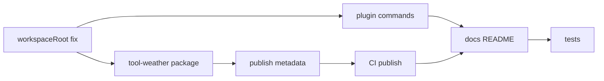

# Iteración 6: Distribución y ecosistema npm

## Objetivo

Instalar Yggdrasil y plugins **sin clonar el monorepo**: paquetes `@yggdrasil/*` publicados en npm, CLI instalable globalmente, comandos `plugin install/enable`, y un plugin de ejemplo (`tool-weather`) verificable vía discovery.

**Duración sugerida:** 2–3 días  
**Depende de:** Iteración 5 (recomendado — plugins de canal maduros; no bloqueante)

**Criterios de éxito:**
1. `pnpm add -D @yggdrasil/cli` (o `npm i -g @yggdrasil/cli`) en un proyecto vacío permite `yggdrasil gateway` con config local
2. `yggdrasil plugin install @yggdrasil/tool-weather` instala el paquete y lo habilita en `yggdrasil.config.json`
3. Tras `yggdrasil run`, `plugins.list` incluye `tool-weather` sin editar código del CLI
4. README documenta instalación desde npm (no solo clonar monorepo)
5. Tag `v0.4.0` (o similar) dispara CI de publicación
6. Tests existentes en verde + ≥4 tests nuevos

**Fuera de alcance:** marketplace web, firmas npm provenance, versionado automático de plugins de terceros, publicación de todos los paquetes del monorepo el día 1 (MVP = core + 1 plugin ejemplo).

---

## Estado actual (gaps)

| Área | Hoy | Gap |
|------|-----|-----|
| npm | `"private": true` en root; paquetes `0.1.0` sin `publishConfig` | Nada publicado |
| CLI `workspaceRoot` | `resolve(__dirname, "../../..")` | **Roto** si CLI se instala desde `node_modules` global |
| Plugin install | Solo `create-plugin` (scaffold local) | Sin `pnpm add` + enable en config |
| Discovery | `node_modules/@yggdrasil/*` implementado | Sin flujo documentado end-to-end |
| Repo | Carpeta `harness_pp` | No alineado con marca Yggdrasil |
| CI | Solo `pnpm build && pnpm test` | Sin pipeline publish |

Referencias:

- [`packages/cli/src/index.ts`](packages/cli/src/index.ts) — `workspaceRoot` hardcoded al monorepo
- [`packages/kernel/src/plugin-loader.ts`](packages/kernel/src/plugin-loader.ts) — `discoverNodeModulesPluginPaths`
- [`package.json`](package.json) — `"private": true`
- [`pnpm-workspace.yaml`](pnpm-workspace.yaml) — `packages/*`, `extensions/*`

---

## Arquitectura objetivo

```mermaid
flowchart TB
  subgraph user [Proyecto usuario]
    CFG[yggdrasil.config.json]
    NM[node_modules/@yggdrasil/*]
  end

  subgraph cli [CLI global o local]
    WR[resolveWorkspaceRoot cwd]
    PI[plugin install]
  end

  subgraph registry [npm]
    CLI_PKG["@yggdrasil/cli"]
    TW["@yggdrasil/tool-weather"]
  end

  PI -->|pnpm add| NM
  PI -->|enable in config| CFG
  WR --> CFG
  CLI_PKG --> cli
  TW --> registry
  NM --> Kernel[discovery loadPlugins]
```

---

## Fase A — Estrategia de publicación

### Paquetes MVP a publicar (orden de dependencias)

Publicar en este orden (cada uno solo depende de los anteriores):

| Orden | Paquete | Notas |
|-------|---------|-------|
| 1 | `@yggdrasil/tools-sdk` | Sin deps internas |
| 2 | `@yggdrasil/sdk` | Dep tools-sdk |
| 3 | `@yggdrasil/config` | |
| 4 | `@yggdrasil/sessions` | |
| 5 | `@yggdrasil/kernel` | |
| 6 | `@yggdrasil/harness-runtime` | |
| 7 | `@yggdrasil/tools-runtime` | |
| 8 | `@yggdrasil/tool-builtin` | |
| 9 | `@yggdrasil/pipeline` | |
| 10 | `@yggdrasil/provider-openai-compat` | |
| 11 | `@yggdrasil/harness-llm` | |
| 12 | `@yggdrasil/gateway` | |
| 13 | `@yggdrasil/channel-tui` | |
| 14 | `@yggdrasil/channel-http` | |
| 15 | `@yggdrasil/cli` | Bin `yggdrasil`; bundle o deps workspace→npm |

**Post-MVP (mismo iter si hay tiempo):** `channel-telegram` como `@yggdrasil/channel-telegram`.

### Cambios en cada `package.json` publicable

```json
{
  "publishConfig": {
    "access": "public",
    "registry": "https://registry.npmjs.org"
  },
  "files": ["dist", "yggdrasil.plugin.json"],
  "repository": {
    "type": "git",
    "url": "https://github.com/<org>/yggdrasil.git",
    "directory": "packages/sdk"
  }
}
```

- Quitar `"private": true` solo en paquetes publicados (mantener root private o usar changesets)
- Version bump alineado: **`0.4.0`** (post iter 4–5) o `0.3.0` si aún en 0.1.0
- `engines.node`: `>=22`

### Herramienta de versionado

**Opción A (recomendada):** [@changesets/cli](https://github.com/changesets/changesets) en root — PRs añaden changeset, merge → `changeset version` + `changeset publish`.

**Opción B (MVP):** script `scripts/publish.sh` que publica en orden fijo con `pnpm publish -r --filter ...`.

Documentar en `docs/publishing.md` (mantenedor).

---

## Fase B — `resolveWorkspaceRoot` (crítico)

**Nuevo:** `packages/cli/src/workspace.ts`

```typescript
export function resolveWorkspaceRoot(cwd = process.cwd()): string {
  // 1. Buscar yggdrasil.config.json hacia arriba desde cwd
  // 2. Si existe, return dirname(config)
  // 3. Si env YGGDRASIL_WORKSPACE, usar eso
  // 4. Fallback: cwd (proyecto usuario con config en .)
}
```

Reemplazar en [`packages/cli/src/index.ts`](packages/cli/src/index.ts):

```typescript
// Antes: resolve(__dirname, "../../..")
const workspaceRoot = resolveWorkspaceRoot();
```

`loadConfig()` ya busca `join(workspaceRoot, "yggdrasil.config.json")` — correcto tras el fix.

**Bootstrap en proyecto usuario:**

```bash
mkdir my-agent && cd my-agent
pnpm init
pnpm add @yggdrasil/cli
npx yggdrasil init   # nuevo comando opcional: copia yggdrasil.config.json ejemplo
```

### `yggdrasil init` (opcional, recomendado en iter 6)

- Escribe `yggdrasil.config.json` mínimo si no existe
- Crea `extensions/` vacío
- Imprime próximos pasos

---

## Fase C — Comandos `yggdrasil plugin`

**Nuevo:** `packages/cli/src/plugin-commands.ts`

### `yggdrasil plugin list`

- Lee `plugins.list` vía kernel bootstrapped o lista config `plugins.installed`

### `yggdrasil plugin install <package>`

```bash
yggdrasil plugin install @yggdrasil/tool-weather
# 1. detect package manager (pnpm > npm)
# 2. exec: pnpm add @yggdrasil/tool-weather
# 3. append to yggdrasil.config.json:
#    plugins.installed: ["tool-weather"]  (nuevo campo)
#    o plugins.load.paths si no tiene manifest en nm (no aplica si scoped)
# 4. discoverNodeModules ya carga @yggdrasil/*
```

### `yggdrasil plugin enable <id>` / `disable <id>`

```json
{
  "plugins": {
    "installed": ["tool-weather", "channel-telegram"],
    "disabled": ["channel-telegram"]
  }
}
```

Loader: skip plugins en `disabled` al importar (nuevo check en `loadPlugins`).

### `yggdrasil plugin create` (alias)

Opcional: `yggdrasil plugin create <name> --kind tool` → delega a `create-plugin`.

Actualizar `printHelp()` con subcomandos plugin.

---

## Fase D — `@yggdrasil/tool-weather`

**Ubicación:** `packages/tool-weather/` (publicable) o `extensions/tool-weather/` copiado a package.

| Archivo | Contenido |
|---------|-----------|
| `package.json` | `"name": "@yggdrasil/tool-weather"` |
| `yggdrasil.plugin.json` | `id: tool-weather`, `compat: >=0.3.0` |
| `src/index.ts` | `defineTool` mock — `get_weather(city)` → JSON fijo |

```typescript
defineTool({
  name: "get_weather",
  description: "Returns mock weather for a city (demo plugin).",
  parameters: {
    type: "object",
    properties: { city: { type: "string" } },
    required: ["city"],
  },
  async execute(_ctx, args) {
    return { city: args.city, tempC: 22, condition: "sunny" };
  },
});
```

Build → `dist/index.js` como entry del manifest.

**Prueba local pre-publish:**

```bash
cd /tmp/test-project
pnpm add file:../../harness_pp/packages/tool-weather
yggdrasil run
# plugins.list → tool-weather
```

---

## Fase E — Rename repo y branding

### Rename

1. Renombrar carpeta local `harness_pp` → `yggdrasil` (manual o `git` sin force)
2. Actualizar referencias en docs si mencionan `harness_pp`
3. `package.json` root ya se llama `yggdrasil` ✅

### README raíz

Secciones nuevas:

```markdown
## Install (npm)

pnpm add -D @yggdrasil/cli
# o: npm install -g @yggdrasil/cli

yggdrasil init
yggdrasil plugin install @yggdrasil/tool-weather
export OLLAMA_API_KEY=...
yggdrasil tui
```

### Docs

**Nuevo:** [`docs/installation.md`](docs/installation.md) — npm global vs local, workspaceRoot, plugin install

**Nuevo:** [`docs/publishing.md`](docs/publishing.md) — mantenedores: changesets, orden publish

---

## Fase F — CI publish

**Nuevo:** `.github/workflows/publish.yml`

```yaml
on:
  push:
    tags: ["v*"]

jobs:
  publish:
    runs-on: ubuntu-latest
    steps:
      - uses: actions/checkout@v4
      - uses: pnpm/action-setup@v4
      - uses: actions/setup-node@v4
        with:
          node-version: 22
          registry-url: https://registry.npmjs.org
      - run: pnpm install --frozen-lockfile
      - run: pnpm build
      - run: pnpm test
      - run: pnpm publish -r --access public
        env:
          NODE_AUTH_TOKEN: ${{ secrets.NPM_TOKEN }}
```

Alternativa con Changesets:

```yaml
- uses: changesets/action@v1
  with:
    publish: pnpm changeset publish
```

**Secrets:** `NPM_TOKEN` con permiso publish para org `@yggdrasil` (crear org npm antes).

---

## Fase G — Config schema extendido

**Archivo:** [`packages/config/src/index.ts`](packages/config/src/index.ts)

```typescript
plugins?: {
  load?: { paths?: string[] };
  discoverNodeModules?: boolean;
  discoverAll?: boolean;
  installed?: string[];      // ids declarativos (doc)
  disabled?: string[];       // ids a no cargar
};
```

`mergeConfig` debe fusionar arrays `installed` / `disabled` sin duplicar.

**Kernel** [`packages/kernel/src/plugin-loader.ts`](packages/kernel/src/plugin-loader.ts):

```typescript
if (options.config.plugins?.disabled?.includes(candidate.manifest.id)) continue;
```

---

## Fase H — Tests

| Archivo | Qué prueba |
|---------|------------|
| `packages/cli/src/workspace.test.ts` | encuentra config subiendo directorios |
| `packages/cli/src/plugin-commands.test.ts` | mutación config install/enable |
| `test/plugin-install.test.ts` | file: dependency tool-weather → plugins.list |
| `test/npm-discovery.test.ts` | paquete en tmp `node_modules/@yggdrasil/x` carga tras add simulado |

No requiere publicar a npm real en CI — usar `pnpm add file:...` o verdaccio local opcional.

---

## Orden de implementación



1. `resolveWorkspaceRoot` + `yggdrasil init`
2. Config `plugins.disabled` + loader skip
3. `plugin install/enable/list`
4. `@yggdrasil/tool-weather`
5. `publishConfig` + version 0.4.0 en paquetes
6. GitHub Actions
7. README + docs/installation.md
8. Rename repo (puede ser último paso manual)
9. Tests

---

## Archivos clave a tocar

| Archivo | Cambio |
|---------|--------|
| [`packages/cli/src/workspace.ts`](packages/cli/src/workspace.ts) | **nuevo** |
| [`packages/cli/src/plugin-commands.ts`](packages/cli/src/plugin-commands.ts) | **nuevo** |
| [`packages/cli/src/index.ts`](packages/cli/src/index.ts) | workspace + subcomandos plugin |
| [`packages/config/src/index.ts`](packages/config/src/index.ts) | plugins.installed/disabled |
| [`packages/kernel/src/plugin-loader.ts`](packages/kernel/src/plugin-loader.ts) | skip disabled |
| [`packages/tool-weather/`](packages/tool-weather/) | **nuevo paquete** |
| `packages/*/package.json` | publishConfig, files, version |
| [`.github/workflows/publish.yml`](.github/workflows/publish.yml) | **nuevo** |
| [`docs/installation.md`](docs/installation.md) | **nuevo** |
| [`README.md`](README.md) | quick start npm |

---

## Demo manual esperada

### Desarrollador (monorepo)

```bash
pnpm build && pnpm test
# Publicar dry-run:
pnpm publish -r --dry-run --access public
```

### Usuario final (proyecto nuevo)

```bash
mkdir ~/my-yggdrasil && cd ~/my-yggdrasil
pnpm init -y
pnpm add @yggdrasil/cli
npx yggdrasil init
npx yggdrasil plugin install @yggdrasil/tool-weather
export OLLAMA_API_KEY=...
npx yggdrasil tui
# > qué clima hay en Madrid?  → get_weather tool
```

### Verificar discovery

```bash
npx yggdrasil gateway  # otra terminal
# WS plugins.list → tool-weather presente
```

---

## Riesgos y mitigaciones

| Riesgo | Mitigación |
|--------|------------|
| workspaceRoot roto en global install | Fase B obligatoria antes de publicar CLI |
| Orden circular de publish | Script con orden topológico fijo |
| Nombre `@yggdrasil` tomado en npm | Verificar org npm antes; alternativa `@yggdrasil-agent` |
| Plugins sin `dist` en npm | `files: ["dist"]` + prepublishOnly build |
| Rename rompe paths absolutos | Solo docs; git history preservado |
| workspace:* en deps publicados | `pnpm publish` reescribe a versión semver en tarball |

---

## Fuera de alcance (recordatorio)

- Marketplace web de plugins
- Verificación de firmas / provenance
- `yggdrasil plugin publish` para terceros
- Publicar los 15 paquetes el día 1 si bloquea — MVP = cli + sdk + kernel + pipeline + gateway + harness-llm + provider + tool-weather

### Subset mínimo viable de publicación

Si el tiempo aprieta, publicar solo:

`tools-sdk`, `sdk`, `config`, `kernel`, `sessions`, `harness-runtime`, `tools-runtime`, `tool-builtin`, `pipeline`, `provider-openai-compat`, `harness-llm`, `gateway`, `channel-tui`, `cli`, `tool-weather`

Dejar `channel-http` para patch `0.4.1`.

---

## Referencias

- Roadmap maestro: [`docs/roadmap-iteraciones.md`](../roadmap-iteraciones.md)
- Iteración 5: [`docs/plans/yggdrasil-iteracion-5.plan.md`](./yggdrasil-iteracion-5.plan.md)
- Discovery npm (iter 3): [`packages/kernel/src/plugin-loader.ts`](../../packages/kernel/src/plugin-loader.ts)
- Crear plugins: [`docs/creating-plugins.md`](../creating-plugins.md)
