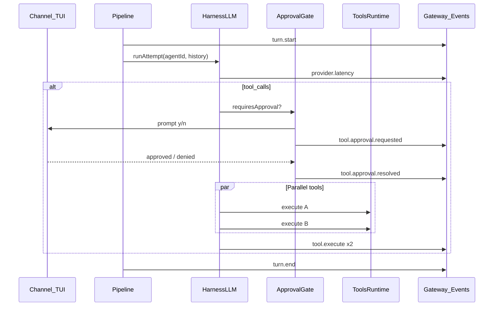
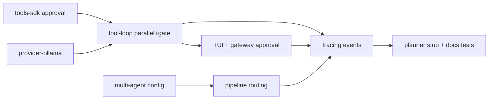

# Iteración 7: Agente avanzado

## Objetivo

Capacidades de agente **production-grade**: confirmación humana antes de tools sensibles, ejecución paralela de tool calls, routing multi-agente, provider Ollama nativo, y observabilidad por turno.

**Duración sugerida:** 4–5 días  
**Depende de:** Iteraciones 4 (sesiones/memoria) y 5 (canales/eventos WS) — iter 6 recomendada pero no bloqueante

**Criterios de éxito:**
1. Tool marcada `requiresApproval: true` → TUI pide `y/n` antes de ejecutar; rechazo devuelve error al LLM sin tumbar el loop
2. Provider devuelve 2+ `tool_calls` en un turn → ejecución en paralelo (`Promise.all`); logs muestran latencias distintas
3. Config con dos agentes (`default` + `coder`) → `chat.send` con `agentId: "coder"` usa su provider/model
4. `@yggdrasil/provider-ollama` registrado y seleccionable en `providers.list`
5. Gateway emite `turn.start`, `tool.execute`, `provider.latency` por WebSocket durante un turn
6. Tests existentes en verde + ≥8 tests nuevos

**Fuera de alcance:** fine-tuning, sandbox OS-level, swarm autónomo multi-agente, RAG, tool approval vía Telegram inline buttons (MVP solo TUI + gateway RPC).

---

## Estado actual (gaps)

| Área | Hoy | Gap |
|------|-----|-----|
| Tool loop | Secuencial `for (call of toolCalls)` | Sin paralelismo |
| Tool approval | No existe | Cualquier tool se ejecuta sin confirmar |
| `AgentToolDefinition` | name, description, execute | Sin `requiresApproval` / `riskLevel` |
| Multi-agente | `resolveAgent(metadata.agentId)` en pipeline | Sin `agentId` en sesión/gateway; agent sin `harness` propio |
| Provider Ollama | Solo `openai-compat` + `ollama.com/v1` | Sin provider nativo `/api/chat` |
| Observabilidad | `chat.delta`, `chat.final` | Sin `turn.*` / `tool.execute` |
| Harness avanzado | `llm` + `echo` | Sin planner/router de ejemplo |

Referencias:

- [`packages/harness-llm/src/tool-loop.ts`](packages/harness-llm/src/tool-loop.ts) — loop secuencial
- [`packages/tools-sdk/src/types.ts`](packages/tools-sdk/src/types.ts) — tool definition mínima
- [`packages/pipeline/src/turn-kernel.ts`](packages/pipeline/src/turn-kernel.ts) — `message.metadata?.agentId`
- [`packages/config/src/index.ts`](packages/config/src/index.ts) — `AgentConfig` con provider/model
- [`packages/gateway/src/server.ts`](packages/gateway/src/server.ts) — eventos WS

---

## Arquitectura objetivo



---

## Fase A — Tool approval (SDK + runtime)

### A.1 — Extender `@yggdrasil/tools-sdk`

**Archivo:** [`packages/tools-sdk/src/types.ts`](packages/tools-sdk/src/types.ts)

```typescript
export type ToolRiskLevel = "safe" | "moderate" | "destructive";

export type AgentToolDefinition = {
  name: string;
  description: string;
  parameters: ToolParameterSchema;
  requiresApproval?: boolean;   // default false
  riskLevel?: ToolRiskLevel;    // default "safe"; "destructive" → requiresApproval true
  execute(ctx: ToolContext, args: Record<string, unknown>): Promise<unknown>;
};
```

Regla en `defineTool`: si `riskLevel === "destructive"` → `requiresApproval = true` salvo override explícito.

### A.2 — Contrato de aprobación

**Archivo:** [`packages/sdk/src/harness.ts`](packages/sdk/src/harness.ts)

```typescript
export type ToolApprovalRequest = {
  sessionKey: string;
  toolName: string;
  args: Record<string, unknown>;
  riskLevel?: ToolRiskLevel;
};

export type ToolApprovalHandler = (
  request: ToolApprovalRequest,
) => Promise<boolean>;

export type HarnessAttemptParams = {
  // ...existente
  approveTool?: ToolApprovalHandler;
};
```

**Config global** [`packages/config/src/index.ts`](packages/config/src/index.ts):

```typescript
harness?: {
  // ...existente
  toolApproval?: "always" | "destructive-only" | "never";  // default "destructive-only"
};
```

### A.3 — Tool loop gate

**Archivo:** [`packages/harness-llm/src/tool-loop.ts`](packages/harness-llm/src/tool-loop.ts)

Antes de `executeTool`:

```typescript
const def = getTool(call.name);
const needsApproval =
  def?.requiresApproval ||
  def?.riskLevel === "destructive" ||
  (config.harness?.toolApproval === "always");

if (needsApproval && options.approveTool) {
  const approved = await options.approveTool({ sessionKey, toolName: call.name, args });
  if (!approved) {
    toolContent = "Error: tool execution denied by user";
    // append tool message y continuar loop (no throw)
  }
}
```

### A.4 — Tool de ejemplo destructiva

Añadir en `@yggdrasil/tool-builtin` o `extensions/`:

```typescript
defineTool({
  name: "delete_file",
  description: "Demo destructive tool (does not delete; requires approval).",
  riskLevel: "destructive",
  parameters: { type: "object", properties: { path: { type: "string" } }, required: ["path"] },
  async execute() {
    return { deleted: false, demo: true };
  },
});
```

---

## Fase B — Ejecución paralela de tools

**Archivo:** [`packages/harness-llm/src/tool-loop.ts`](packages/harness-llm/src/tool-loop.ts)

Reemplazar loop secuencial:

```typescript
const results = await Promise.all(
  result.toolCalls.map(async (call) => {
    const started = Date.now();
    // ...approval + execute...
  options.onToolExecute?.({ name: call.name, durationMs: Date.now() - started });
    return { call, toolContent };
  }),
);

for (const { call, toolContent } of results) {
  messages.push({ role: "tool", content: toolContent, tool_call_id: call.id, name: call.name });
}
```

**Orden de tool messages:** preservar orden de `toolCalls` del modelo (mapear por id tras `Promise.all`).

**Config opcional:**

```typescript
harness?: {
  parallelToolCalls?: boolean;  // default true
};
```

Si `false`, mantener comportamiento secuencial (útil para tests).

---

## Fase C — Aprobación en TUI y Gateway

### TUI

**Archivo:** [`packages/channel-tui/src/channel.ts`](packages/channel-tui/src/channel.ts) o wiring en pipeline

Cuando `approveTool` se invoca desde TUI channel:
- Imprimir: `⚠ Aprobar tool delete_file con {"path":"..."}? [y/N]`
- Usar `readline` one-shot o flag en sesión TUI
- Timeout 60s → deny

**Pipeline** construye `approveTool` cuando el canal soporta interacción (`capabilities.interactive?: boolean` en SDK channel — nuevo campo opcional).

### Gateway

**Eventos WS** (suscribir en [`server.ts`](packages/gateway/src/server.ts)):

| Evento | Payload |
|--------|---------|
| `tool.approval.requested` | `{ sessionKey, toolName, args, riskLevel }` |
| `tool.approval.resolved` | `{ sessionKey, toolName, approved }` |

**RPC nuevo:** `tools.approve`

```json
{
  "method": "tools.approve",
  "params": { "sessionKey": "...", "requestId": "...", "approved": true }
}
```

**Pending approvals store:** `Map<requestId, { resolve: (ok: boolean) => void }>` en gateway context (MVP in-memory).

Clientes headless (HTTP/Telegram) sin approval → deny por defecto o config `harness.toolApproval: "never"` para esos canales (fase futura: metadata por canal).

---

## Fase D — Multi-agente

### D.1 — Config

```json
{
  "defaultAgent": "default",
  "agents": [
    { "id": "default", "provider": "openai-compat", "model": "gpt-oss:120b" },
    { "id": "coder", "provider": "openai-compat", "model": "gpt-4o-mini", "harness": "llm", "label": "Coder" }
  ]
}
```

Extender `AgentConfig`:

```typescript
export type AgentConfig = {
  id: string;
  label?: string;
  provider?: string;
  model?: string;
  harness?: string;        // pinned harness id; si omitido → selector auto
  systemPrompt?: string;   // opcional: prepend system message
};
```

### D.2 — Pipeline

**Archivo:** [`packages/pipeline/src/turn-kernel.ts`](packages/pipeline/src/turn-kernel.ts)

```typescript
const agent = resolveAgent(config, message.metadata?.agentId ?? sessionRecord?.agentId);
// selectHarness con harness pinned si agent.harness
const selection = agent.harness
  ? { harness: getHarness(agent.harness)!.harness, harnessId: agent.harness, ... }
  : selectHarness({ ...ctx, config });
```

Inyectar `systemPrompt` del agente al historial si existe (prepend virtual, no persistir duplicado cada turn).

### D.3 — Gateway + sesión

- `chat.send` acepta `agentId` en params → `message.metadata.agentId`
- `sessions.patch` (iter 4) persiste `agentId` por sesión
- TUI comando: `/agent coder` → set metadata en sesión vía patch local

### D.4 — `agents.list` enriquecido

Ya existe — añadir `harness`, `systemPrompt` truncado en respuesta.

---

## Fase E — `@yggdrasil/provider-ollama` (nativo)

**Nuevo paquete:** `packages/provider-ollama/`

| Aspecto | OpenAI-compat (hoy) | Ollama nativo |
|---------|---------------------|---------------|
| Endpoint | `/v1/chat/completions` | `/api/chat` |
| Tools | OpenAI format | Ollama `tools` + `tool_calls` en message |
| Stream | SSE OpenAI | NDJSON stream nativo |
| Auth | Bearer API key | Local sin key; cloud con key |

### Implementación MVP

```typescript
export const OLLAMA_PROVIDER_ID = "ollama";

createOllamaProvider({ globalConfig }): ProviderPlugin {
  id: "ollama",
  listModels: () => fetch(`${baseUrl}/api/tags`),
  chatComplete: (ctx, params) => POST /api/chat { model, messages, tools, stream: false },
  chatCompleteStream: (ctx, params, onEvent) => parse NDJSON lines,
}
```

**Mapper:** `packages/provider-ollama/src/messages.ts` — convertir `ChatMessage[]` ↔ formato Ollama.

**Config:**

```json
"providers": {
  "ollama": {
    "baseUrl": "http://127.0.0.1:11434",
    "defaultModel": "llama3.2"
  }
}
```

**Plugin:** `yggdrasil.plugin.json` en package; discovery desde `packages/`.

**Fallback:** si nativo falla, documentar que `openai-compat` sigue disponible para Ollama Cloud.

---

## Fase F — Tracing y turn logs

### Eventos estándar

| Evento | Cuándo | Payload |
|--------|--------|---------|
| `turn.start` | Inicio `dispatchToHarness` | `{ sessionKey, agentId, harnessId, messagePreview }` |
| `turn.end` | Fin turn | `{ sessionKey, harnessId, classification, durationMs }` |
| `tool.execute` | Tras cada tool | `{ sessionKey, toolName, durationMs, ok }` |
| `provider.latency` | Tras cada LLM call | `{ sessionKey, model, durationMs, iteration }` |

### Wiring

- **Pipeline** emite `turn.start` / `turn.end` vía callback opcional o acceso a `EventBus` del kernel
- **tool-loop** recibe `onProviderLatency`, `onToolExecute`
- **Gateway** suscribe todos en [`server.ts`](packages/gateway/src/server.ts) (igual que `chat.delta`)

### RPC opcional: `turns.recent`

```typescript
registerCoreMethod("turns.recent", async () => ({
  turns: turnLogRingBuffer.snapshot(),  // últimos 50 en memoria
}));
```

**Nuevo:** `packages/gateway/src/turn-log.ts` — ring buffer in-memory (MVP).

### health

```typescript
version: "0.5.0",
features: ["tool-approval", "parallel-tools", "tracing", "multi-agent"],
```

---

## Fase G — Harness planner (ejemplo)

**Nuevo:** `extensions/harness-planner/` o `packages/harness-planner/`

Harness ligero que **no reemplaza** LLM sino demuestra routing:

```typescript
{
  id: "planner",
  supports(ctx) {
    return ctx.runtime === "plan" ? { supported: true, priority: 200 } : { supported: false };
  },
  async runAttempt(params) {
    // MVP: devuelve plan en texto fijo o delega a llm harness internamente
    return { text: `Plan for: ${params.message}\n1. Analyze\n2. Execute tools\n3. Respond`, classification: "ok" };
  },
}
```

**Uso:** agente con `"harness": "planner"` o metadata `runtime: "plan"`.

Documentar patrón para sub-agentes futuros (iter 8+).

---

## Fase H — Docs y tests

### Docs

**Nuevo:** [`docs/advanced-agent.md`](docs/advanced-agent.md)

- Tool approval (TUI, gateway, config)
- Parallel tools
- Multi-agente (`agentId`, `/agent`)
- Provider Ollama nativo vs openai-compat
- Eventos de tracing (tabla + ejemplos websocat)

### Tests

| Archivo | Qué prueba |
|---------|------------|
| `packages/harness-llm/src/tool-loop.test.ts` | approval deny/approve, parallel timing |
| `packages/tools-sdk/src/types.test.ts` | destructive → requiresApproval |
| `packages/provider-ollama/src/messages.test.ts` | message mapping |
| `test/multi-agent.test.ts` | dos agentes, distinto model en mock |
| `test/tracing-gateway.test.ts` | WS recibe turn.start, tool.execute |
| `test/tool-approval-gateway.test.ts` | tools.approve RPC |
| `packages/pipeline/src/pipeline.test.ts` | agent.harness pinned |

---

## Orden de implementación



1. SDK tools approval + config `toolApproval`
2. tool-loop: approval + parallel + hooks timing
3. Pipeline → approveTool + multi-agent harness selection
4. TUI prompt + gateway events + `tools.approve`
5. `@yggdrasil/provider-ollama`
6. Tracing event bus + turn log
7. harness-planner ejemplo
8. Docs + tests

---

## Archivos clave a tocar

| Archivo | Cambio |
|---------|--------|
| [`packages/tools-sdk/src/types.ts`](packages/tools-sdk/src/types.ts) | requiresApproval, riskLevel |
| [`packages/sdk/src/harness.ts`](packages/sdk/src/harness.ts) | approveTool, ToolApprovalRequest |
| [`packages/sdk/src/channel.ts`](packages/sdk/src/channel.ts) | `interactive?: boolean` capability |
| [`packages/harness-llm/src/tool-loop.ts`](packages/harness-llm/src/tool-loop.ts) | parallel + approval |
| [`packages/harness-llm/src/harness.ts`](packages/harness-llm/src/harness.ts) | wire approveTool |
| [`packages/pipeline/src/turn-kernel.ts`](packages/pipeline/src/turn-kernel.ts) | multi-agent, tracing, approveTool |
| [`packages/config/src/index.ts`](packages/config/src/index.ts) | toolApproval, agent.systemPrompt |
| [`packages/gateway/src/methods.ts`](packages/gateway/src/methods.ts) | tools.approve, turns.recent |
| [`packages/gateway/src/server.ts`](packages/gateway/src/server.ts) | suscribir eventos tracing |
| [`packages/provider-ollama/`](packages/provider-ollama/) | **nuevo** |
| [`packages/channel-tui/src/channel.ts`](packages/channel-tui/src/channel.ts) | approval prompt |
| [`extensions/harness-planner/`](extensions/harness-planner/) | **nuevo** |
| [`docs/advanced-agent.md`](docs/advanced-agent.md) | **nuevo** |

---

## Demo manual esperada

```bash
pnpm build
export OLLAMA_API_KEY=...

# yggdrasil.config.json — dos agentes + harness.toolApproval: destructive-only
node packages/cli/dist/index.js tui
```

**Approval:**

```
> borra el archivo /tmp/test usando delete_file
⚠ Aprobar tool delete_file con {"path":"/tmp/test"}? [y/N] y
→ (respuesta del agente tras ejecutar demo tool)
```

**Multi-agente:**

```
/agent coder
> escribe una función fibonacci en Python
# → usa model del agente coder
```

**Tracing (otra terminal):**

```bash
websocat ws://127.0.0.1:18789
# observar: turn.start, tool.execute, provider.latency, turn.end, chat.delta, chat.final
```

**Ollama local:**

```json
"agents": [{ "id": "local", "provider": "ollama", "model": "llama3.2" }]
```

```bash
# OLLAMA_HOST=http://127.0.0.1:11434
node packages/cli/dist/index.js tui
```

---

## Riesgos y mitigaciones

| Riesgo | Mitigación |
|--------|------------|
| TUI bloqueada esperando approval | Timeout 60s → deny |
| Parallel tools con side effects | Doc: marcar sequential si needed; approval first |
| Ollama API distinta por versión | Pin versión mínima en docs; tests contra mock |
| Gateway approval sin UI | `tools.approve` RPC; Telegram deny default |
| systemPrompt duplicado en sesión | Prepend virtual solo en runAttempt |
| Iter 4/5 no implementadas | Approval y parallel no dependen de compaction; multi-agent usa metadata ya existente |

---

## Fuera de alcance (recordatorio)

- Fine-tuning y training
- Sandboxing OS (containers seccomp)
- Swarm / autónomo multi-agente
- Inline keyboards Telegram para approval
- Persistir turn log en disco (solo ring buffer MVP)

---

## Referencias

- Roadmap maestro: [`docs/roadmap-iteraciones.md`](../roadmap-iteraciones.md)
- Iteración 4 (sesiones): [`docs/plans/yggdrasil-iteracion-4.plan.md`](./yggdrasil-iteracion-4.plan.md)
- Iteración 5 (gateway events): [`docs/plans/yggdrasil-iteracion-5.plan.md`](./yggdrasil-iteracion-5.plan.md)
- Ollama API: https://github.com/ollama/ollama/blob/main/docs/api.md
- Tool loop actual: [`packages/harness-llm/src/tool-loop.ts`](../../packages/harness-llm/src/tool-loop.ts)
