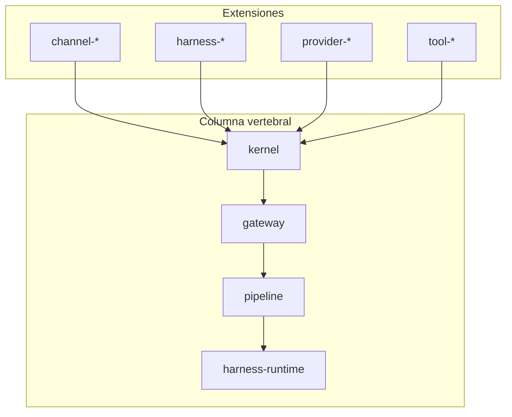
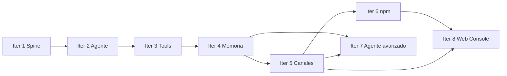

# Roadmap de iteraciones — Yggdrasil

Documento maestro para planificar y ejecutar el desarrollo por fases. Cada iteración futura debe convertirse en un **plan formal** (con todos, archivos clave y criterios de éxito) antes de implementarse.

**Estado del repo:** `harness_pp` (pendiente renombrar a `yggdrasil`)  
**Scope npm:** `@yggdrasil/*`  
**CLI:** `yggdrasil`  
**Config:** `yggdrasil.config.json`  
**Tests actuales:** `pnpm test` (mock) + `pnpm test:live` (Ollama Cloud) — ver [testing.md](./testing.md)

---

## Cómo usar este documento

1. Elige la siguiente iteración según la tabla de prioridad al final.
2. Crea un plan en Cursor a partir de la sección correspondiente (objetivo, gaps, entregables, archivos, demo).
3. No mezcles iteraciones: cada una debe dejar tests en verde y una demo manual reproducible.
4. Al cerrar una iteración, marca ✅ en este doc y enlaza el plan ejecutado.

---

## Visión

Yggdrasil es una plataforma **plug-and-play** inspirada en OpenClaw: un **kernel** con registry de plugins, un **pipeline** unificado (canal → harness → outbound), un **gateway** WebSocket como bus, y extensiones para canales, harnesses, providers y tools.



---

## Iteración 1 — Spine ✅

**Estado:** Completada  
**Plan de referencia:** `harness_pp_spine`

### Objetivo

Columna vertebral mínima: kernel, SDK, pipeline, gateway, harness echo builtin, TUI como canal de primera clase.

### Entregables

| Paquete | Rol |
|---------|-----|
| `@yggdrasil/sdk` | Contratos: `YggdrasilPlugin`, `AgentHarness`, `ChannelPlugin`, `ProviderPlugin` |
| `@yggdrasil/kernel` | Registry, plugin loader, lifecycle |
| `@yggdrasil/pipeline` | `TurnKernel` + `ReplyDispatcher` |
| `@yggdrasil/gateway` | WebSocket RPC + `ChannelManager` |
| `@yggdrasil/harness-runtime` | Selector + harness echo builtin |
| `@yggdrasil/channel-tui` | Terminal como canal |
| `@yggdrasil/cli` | Binario CLI |
| `extensions/echo-channel` | Plugin de ejemplo |

### Criterio de éxito

Un desarrollador externo puede crear `extensions/my-channel/`, arrancar `yggdrasil run`, y ver su canal en `plugins.list` sin tocar kernel ni pipeline.

### Demo

```bash
pnpm build && pnpm test
node packages/cli/dist/index.js tui
```

---

## Iteración 2 — Agente conversacional + sesiones + HTTP ✅

**Estado:** Completada  
**Plan de referencia:** `yggdrasil_iteración_2`

### Objetivo

Pasar de eco a **chat multi-turno** con LLM, historial en disco, y un segundo canal real (HTTP).

### Entregables

| Paquete / feature | Rol |
|-------------------|-----|
| `@yggdrasil/sessions` | `SessionStore` en `~/.yggdrasil/sessions` |
| `@yggdrasil/provider-openai-compat` | Provider con `baseUrl` configurable |
| `@yggdrasil/harness-llm` | Harness que llama `chatComplete` |
| `@yggdrasil/channel-http` | `POST /inbound` puerto 18790 |
| Gateway | `sessions.list/get/reset`, `providers.list` |
| TUI | Comando `/reset` |
| Pipeline | Append user/assistant, pasa `history` al harness |
| Fallback | Echo si LLM sin API key |

### Criterios de éxito

1. TUI recuerda contexto entre mensajes.
2. `POST /inbound` responde igual que TUI para el mismo `sessionKey`.
3. `sessions.list` devuelve sesiones reales.
4. Echo sigue como fallback sin API key.

### Fuera de alcance (pospuesto a iter 3+)

- Streaming SSE
- Tools / function calling
- Compaction de sesiones
- Publicación npm
- Renombrar carpeta del repo

### Demo

```bash
export OLLAMA_API_KEY=...   # o OPENAI_API_KEY
node packages/cli/dist/index.js tui

curl -X POST http://127.0.0.1:18790/inbound \
  -H 'Content-Type: application/json' \
  -d '{"message":"hola","sessionKey":"http:test:curl"}'
```

---

## Iteración 3 — Tools + streaming + DX plug-and-play ✅

**Estado:** Completada  
**Plan de referencia:** `yggdrasil_iteración_3`

### Objetivo

De chatbot a **agente con herramientas**, streaming en TUI/gateway, y DX para crear plugins sin tocar el CLI.

### Entregables

| Paquete / feature | Rol |
|-------------------|-----|
| `@yggdrasil/tools-sdk` | `defineTool()`, schemas JSON |
| `@yggdrasil/tools-runtime` | Registry, `executeTool`, `resolveTools`, `toolsToOpenAI` |
| `@yggdrasil/tool-builtin` | Tools `datetime`, `echo` |
| Harness LLM | `tool-loop.ts`, `maxToolIterations`, `onDelta` |
| Provider openai-compat | `chatCompleteStream` SSE + tools en body |
| Pipeline | `onBlock` → `onDelta` |
| TUI | `sendBlock` con `\r` |
| Gateway | `chat.delta` por WebSocket |
| Discovery | `node_modules/@yggdrasil/*` |
| CLI | `create-plugin`, sin `CORE_PLUGINS` hardcoded |
| Docs | `docs/creating-plugins.md` |
| Ejemplo | `extensions/tool-datetime`, `extensions/my-tool` |

### Criterios de éxito

1. Tool loop: call → execute → re-prompt (máx. N iteraciones).
2. Plugin externo registra tool con schema y el agente la invoca.
3. TUI muestra streaming; gateway emite `chat.delta`.
4. Plugin en `extensions/` o `node_modules/@yggdrasil/*` carga sin modificar CLI.
5. `yggdrasil create-plugin my-tool --kind tool` genera proyecto válido.

### Fuera de alcance (pospuesto)

- Streaming en canal HTTP
- Function calling nativo Ollama (formato no-OpenAI)
- Publicación npm pública
- Compaction de historial

### Fix post-iteración

- Serialización OpenAI de `tool_calls` en re-prompt (error `invalid tool call arguments` con Ollama).
- `tsconfig` en plantillas `create-plugin`: `../../tsconfig.base.json`.

### Demo

```bash
pnpm build
node packages/cli/dist/index.js tui
# > usa la herramienta my-tool_echo con el mensaje "hola mundo"

node packages/cli/dist/index.js create-plugin my-tool --kind tool
cd extensions/my-tool && pnpm install && pnpm build
```

---

## Deuda técnica transversal

Items pequeños que conviene resolver en la próxima iteración o como “iteración 3.5”:

| Item | Estado | Archivo / nota |
|------|--------|----------------|
| `sessions.patch` | Stub | `packages/gateway/src/methods.ts` | ✅ Iter 4 |
| `tools.list` en gateway | No existe | Validar tools solo vía chat o script | ✅ Iter 4 |
| `health.version` | `0.2.0` fijo | `packages/gateway/src/methods.ts` | ✅ Iter 4 |
| README raíz | Desactualizado | No menciona tools, `create-plugin` | ✅ Iter 4 |
| Renombrar repo | Pendiente | `harness_pp` → `yggdrasil` | — |
| Historial con tool messages | Parcial | Sesión guarda user/assistant; tool turns no persisten en disco | ✅ Iter 4 |
| Convención nombres tools | Sin doc | Preferir `snake_case` sin guiones para compatibilidad LLM | ✅ Iter 4 |
| `pluginApi` en manifiestos core | `>=0.1.0` | Unificar a `>=0.3.0` | ✅ Iter 4 |

---

## Iteración 4 — Memoria, sesiones y observabilidad ✅

**Estado:** Completada  
**Plan de referencia:** [yggdrasil_iteración_4](./plans/yggdrasil-iteracion-4.plan.md)

### Objetivo

Conversaciones **largas y debuggables**: compaction de historial, sesiones editables, visibilidad de tools sin pasar por el LLM.

### Gaps actuales

| Área | Hoy | Gap |
|------|-----|-----|
| Sesiones | Truncado por `maxMessages` (50) | Sin resumen/compaction |
| `sessions.patch` | Retorna `{ patched: true }` | Sin implementación |
| Tool turns | Ejecutados en runtime | No persistidos en `SessionStore` |
| Tools | Solo vía chat | Sin `tools.list` RPC |
| Límites | Por conteo de mensajes | Sin límite por tokens |

### Entregables propuestos

| # | Entregable | Descripción |
|---|------------|-------------|
| 4.1 | `@yggdrasil/sessions` — compaction | Resumir mensajes antiguos vía LLM o regla fija; config `sessions.compactThreshold` |
| 4.2 | `sessions.patch` real | Actualizar metadata, título, `agentId` por sesión |
| 4.3 | Persistir tool messages | Guardar assistant+tool en historial (formato compatible con re-prompt) |
| 4.4 | Gateway `tools.list` | Lista tools registradas (nombre, descripción, schema) |
| 4.5 | Gateway `health` v0.4.0 | Versión alineada con `CURRENT_PLUGIN_API_VERSION` |
| 4.6 | Config `sessions.maxTokens` | Opcional; estimación simple antes de llamar al provider |
| 4.7 | Docs + tests | `docs/sessions.md`, tests compaction + `tools.list` |

### Archivos clave a tocar

- `packages/sessions/src/store.ts`
- `packages/pipeline/src/turn-kernel.ts`
- `packages/gateway/src/methods.ts`
- `packages/config/src/index.ts`
- `packages/harness-llm/src/harness.ts` (hook pre-turn compaction)

### Criterios de éxito

1. Sesión con 100+ mensajes sigue respondiendo (con compaction automática).
2. `tools.list` muestra `my-tool_echo`, `datetime`, etc.
3. `sessions.patch` persiste cambios en disco.
4. Tras un tool call, `sessions.get` refleja el intercambio (o un resumen).
5. Tests existentes en verde + ≥4 tests nuevos.

### Fuera de alcance

- Compaction semántica multi-agente
- Vector DB / RAG
- UI web de sesiones

### Demo esperada

```bash
node packages/cli/dist/index.js gateway
# WS: tools.list → incluye my-tool_echo
# WS: sessions.get → historial con tool exchange
# TUI: conversación larga sin error de contexto
```

### Todos sugeridos para el plan

- `sessions-compaction` — compaction en SessionStore + config
- `sessions-tool-history` — persistir tool turns
- `gateway-tools-list` — RPC tools.list
- `gateway-sessions-patch` — implementar sessions.patch
- `docs-tests-iter4` — docs + tests E2E

---

## Iteración 5 — Canales externos + seguridad ✅

**Estado:** Completada  
**Plan de referencia:** [yggdrasil_iteración_5](./plans/yggdrasil-iteracion-5.plan.md)

### Objetivo

Que Yggdrasil viva **fuera de la terminal**: primer canal de mensajería real, auth en APIs, streaming HTTP opcional.

### Gaps actuales

| Área | Hoy | Gap |
|------|-----|-----|
| Canales | TUI + HTTP inbound | Sin Telegram/Discord/Slack |
| HTTP | Respuesta síncrona al final | Sin SSE/streaming |
| Gateway | Abierto en localhost | Sin auth ni rate limit |
| Clientes | Solo TUI + curl | Sin cliente web mínimo |

### Entregables propuestos

| # | Entregable | Descripción |
|---|------------|-------------|
| 5.1 | `@yggdrasil/channel-telegram` (o similar) | Primer canal externo; webhook o long-polling |
| 5.2 | Auth gateway + HTTP | API key en config; rechazar requests sin token |
| 5.3 | Streaming HTTP (SSE) | `POST /inbound` con `Accept: text/event-stream` opcional |
| 5.4 | `sessionKey` estable por usuario externo | Mapeo `telegram:userId` → sesión |
| 5.5 | Plantilla `create-plugin --kind channel` mejorada | Ejemplo webhook documentado |
| 5.6 | Docs + tests | Guía “conectar Telegram”, E2E mock |

### Archivos clave a tocar

- Nuevo `packages/channel-telegram/` o `extensions/channel-telegram/`
- `packages/channel-http/src/channel.ts`
- `packages/gateway/src/server.ts`
- `yggdrasil.config.json` — sección `auth`

### Criterios de éxito

1. Mensaje en Telegram → misma respuesta que TUI para el mismo usuario/sesión.
2. HTTP sin API key → 401.
3. (Opcional) Cliente curl recibe chunks SSE.
4. Canal se carga solo por discovery; cero cambios en CLI core.

### Fuera de alcance

- Multi-cuenta Telegram por agente
- Billing / cuotas por usuario
- App móvil nativa

### Demo esperada

```bash
# config con telegram.botToken + gateway.auth.apiKey
node packages/cli/dist/index.js run
# Mensaje en Telegram → respuesta del agente con tools
```

### Todos sugeridos para el plan

- `channel-telegram` — plugin canal Telegram
- `auth-gateway-http` — API keys
- `http-streaming-sse` — SSE en channel-http
- `docs-tests-iter5` — docs + tests

---

## Iteración 6 — Distribución y ecosistema npm ✅

**Estado:** Completada  
**Plan de referencia:** [yggdrasil_iteración_6](./plans/yggdrasil-iteracion-6.plan.md)  
**Duración sugerida:** 2–3 días  
**Depende de:** Iteración 5 (recomendado para tener plugins de ejemplo maduros)

### Objetivo

Instalar Yggdrasil y plugins **sin clonar el monorepo**: paquetes publicados, CLI de instalación, rename del repo.

### Gaps actuales

| Área | Hoy | Gap |
|------|-----|-----|
| Distribución | Monorepo local | Paquetes no publicados en npm |
| Discovery | `node_modules/@yggdrasil/*` | Sin flujo `pnpm add` documentado end-to-end |
| Repo | `harness_pp` | Nombre no alineado con marca |
| CLI | `create-plugin` | Sin `plugin install` / `plugin enable` |

### Entregables propuestos

| # | Entregable | Descripción |
|---|------------|-------------|
| 6.1 | Publicar paquetes core | `sdk`, `kernel`, `cli`, `tools-sdk`, etc. |
| 6.2 | `yggdrasil plugin install <pkg>` | Instala npm + habilita en config |
| 6.3 | Plugin de ejemplo publicado | `@yggdrasil/tool-weather` o similar |
| 6.4 | Renombrar repo | `harness_pp` → `yggdrasil` |
| 6.5 | README + branding | Quick start desde npm global |
| 6.6 | CI publish | GitHub Actions en tag |

### Criterios de éxito

1. `npm install -g @yggdrasil/cli` (o `pnpm add`) funciona en proyecto vacío.
2. `pnpm add @yggdrasil/tool-weather` → aparece en `plugins.list` tras `yggdrasil run`.
3. README refleja instalación sin clonar.

### Fuera de alcance

- Marketplace web
- Versionado semver automático de plugins de terceros
- Firmas de paquetes

### Todos sugeridos para el plan

- `npm-publish-core` — publicar paquetes
- `cli-plugin-install` — comando install
- `repo-rename` — rename + paths
- `docs-tests-iter6` — guía instalación npm

---

## Iteración 8 — Web Console ✅

**Estado:** Completada  
**Plan de referencia:** [yggdrasil_iteración_8](./plans/yggdrasil-iteracion-8.plan.md)

### Objetivo

Dashboard en browser: estado del sistema, chat con streaming, sesiones y configuración de agente/harness/canales sin editar JSON.

### Entregables

| # | Entregable | Descripción |
|---|------------|-------------|
| 8.1 | `@yggdrasil/web-console` | SPA React + Vite |
| 8.2 | Gateway `/ui` | Static files embebidos |
| 8.3 | `config.get` / `config.patch` | RPC con secrets sanitizados |
| 8.4 | Pantallas | Overview, Chat, Sessions, Settings |
| 8.5 | Docs + tests | `docs/web-console.md`, e2e iter8 |

### Criterios de éxito

1. `http://127.0.0.1:18789/ui` tras `yggdrasil gateway`
2. Auth WS integrada en UI
3. Chat con `chat.delta` / `chat.final`
4. Settings persiste harness y canales en config

---

## Iteración 7 — Agente avanzado

**Estado:** Plan creado  
**Plan de referencia:** [yggdrasil_iteración_7](./plans/yggdrasil-iteracion-7.plan.md)  
**Duración sugerida:** 4–5 días  
**Depende de:** Iteraciones 4 y 5

### Objetivo

Capacidades de agente **production-grade**: aprobación de tools, paralelismo, multi-agente, providers nativos, observabilidad.

### Entregables propuestos

| # | Entregable | Descripción |
|---|------------|-------------|
| 7.1 | Tool approval | Pausar loop y pedir confirmación (TUI + gateway event) |
| 7.2 | Parallel tool calls | Ejecutar tools independientes en paralelo |
| 7.3 | Multi-agente | Routing por `agentId`; distintos provider/model/harness |
| 7.4 | Provider Ollama nativo | `@yggdrasil/provider-ollama` sin capa OpenAI-compat |
| 7.5 | Tracing / turn logs | Eventos `turn.start`, `tool.execute`, `provider.latency` |
| 7.6 | Harness plugins avanzados | Ej. planner, router, sub-agentes |

### Criterios de éxito

1. Tool destructiva requiere `y` en TUI antes de ejecutar.
2. Dos tool calls en un turn → ejecución paralela medible en logs.
3. Dos agentes en config → mensaje con `agentId` usa el correcto.

### Fuera de alcance

- Fine-tuning
- Sandboxing OS-level de tools
- Swarm multi-agente autónomo

---

## Iteración 8+ — Ideas (sin compromiso)

| Tema | Descripción |
|------|-------------|
| **RAG / memoria larga** | Embeddings, búsqueda en documentos, tool `search_docs` |
| **Skills** | Paquetes de prompts + tools preconfigurados |
| **Compaction inteligente** | Resumen por ventana con modelo barato |
| **Plugin marketplace** | Registry curado de `@yggdrasil/*` |
| **Desktop (Tauri)** | App empaquetada con gateway embebido |
| **Voice channel** | STT/TTS como canal |

---

## Mapa de dependencias



---

## Prioridad recomendada

| Orden | Iteración | Si tu prioridad es… |
|-------|-----------|---------------------|
| 1 | **4 — Memoria** | Usar TUI a diario con conversaciones largas |
| 2 | **5 — Telegram** | Recibir mensajes desde el móvil |
| 3 | **6 — npm** | Compartir / open source |
| 4 | **7 — Agente avanzado** | Tools sensibles, multi-agente |
| — | **Deuda 3.5** | `tools.list`, README, rename (1 día) |

---

## Inventario de paquetes actual

| Paquete | Versión lógica | Iteración |
|---------|----------------|-----------|
| `@yggdrasil/sdk` | 0.1.0 | 1 |
| `@yggdrasil/kernel` | 0.1.0 | 1 |
| `@yggdrasil/pipeline` | 0.1.0 | 1 |
| `@yggdrasil/gateway` | 0.1.0 | 1 |
| `@yggdrasil/harness-runtime` | 0.1.0 | 1 |
| `@yggdrasil/channel-tui` | 0.1.0 | 1 |
| `@yggdrasil/cli` | 0.1.0 | 1 |
| `@yggdrasil/config` | 0.1.0 | 1 |
| `@yggdrasil/sessions` | 0.1.0 | 2 |
| `@yggdrasil/provider-openai-compat` | 0.1.0 | 2 |
| `@yggdrasil/harness-llm` | 0.1.0 | 2 |
| `@yggdrasil/channel-http` | 0.1.0 | 2 |
| `@yggdrasil/tools-sdk` | 0.1.0 | 3 |
| `@yggdrasil/tools-runtime` | 0.1.0 | 3 |
| `@yggdrasil/tool-builtin` | 0.4.0 | 3 |
| `@yggdrasil/tool-weather` | 0.4.0 | 6 |
| `@yggdrasil/web-console` | 0.5.0 | 8 |

**Plugin API actual:** `0.3.0` (`CURRENT_PLUGIN_API_VERSION` en SDK)

---

## Gateway RPC — inventario

| Método | Estado | Iteración |
|--------|--------|-----------|
| `health` | ✅ | 1 |
| `plugins.list` | ✅ | 1 |
| `agents.list` | ✅ | 2 |
| `harnesses.list` | ✅ | 1 |
| `providers.list` | ✅ | 2 |
| `channels.status` | ✅ | 1 |
| `channels.start/stop` | ✅ | 1 |
| `sessions.list/get/reset` | ✅ | 2 |
| `sessions.patch` | ✅ | 4 |
| `chat.send` | ✅ | 1 (+ streaming iter 3) |
| `chat.subscribe` | ✅ | 1 |
| `tools.list` | ✅ | 4 |
| `config.get` / `config.patch` | ✅ | 8 |
| `auth` | ✅ | 5 |

**Eventos WebSocket:** `chat.final`, `chat.delta`

---

## Plantilla para crear el próximo plan

Al crear el plan de Iteración N en Cursor, copia esta estructura:

```markdown
---
name: Yggdrasil Iteración N
overview: "Una línea"
todos:
  - id: todo-id
    content: Descripción
    status: pending
---

# Iteración N: Título

## Objetivo
## Criterios de éxito
## Estado actual (gaps)
## Arquitectura objetivo (diagrama)
## Fases A, B, C…
## Archivos clave
## Fuera de alcance
## Demo manual
## Orden de implementación
```

---

## Testing

Suite por capas (iter 1–4 + extensible para 5+):

| Capa | Comando |
|------|---------|
| Unit + integration + E2E mock | `pnpm test` |
| E2E live Ollama Cloud | `pnpm test:live` (requiere `OLLAMA_API_KEY`) |

Documentación: [testing.md](./testing.md) — helpers en `test/helpers/`, escenarios en `test/e2e/`.

---

## Referencias

- [Testing](./testing.md)
- [Configuración del provider](./provider-config.md)
- [Crear plugins](./creating-plugins.md)
- [Plan Iteración 4 — Memoria y sesiones](./plans/yggdrasil-iteracion-4.plan.md)
- [Plan Iteración 5 — Canales y seguridad](./plans/yggdrasil-iteracion-5.plan.md)
- [Plan Iteración 6 — Distribución npm](./plans/yggdrasil-iteracion-6.plan.md)
- [Plan Iteración 7 — Agente avanzado](./plans/yggdrasil-iteracion-7.plan.md)
- Planes Cursor (local): `.cursor/plans/yggdrasil_iteración_*`
