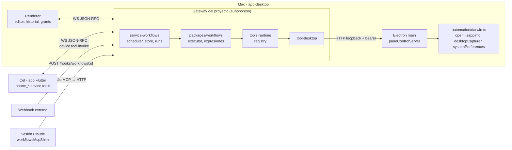
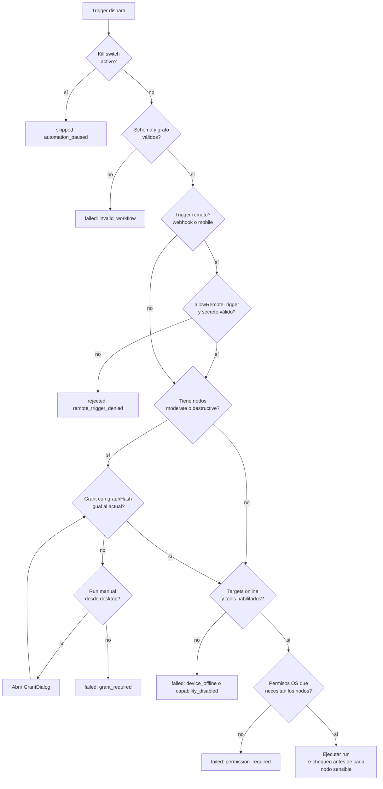
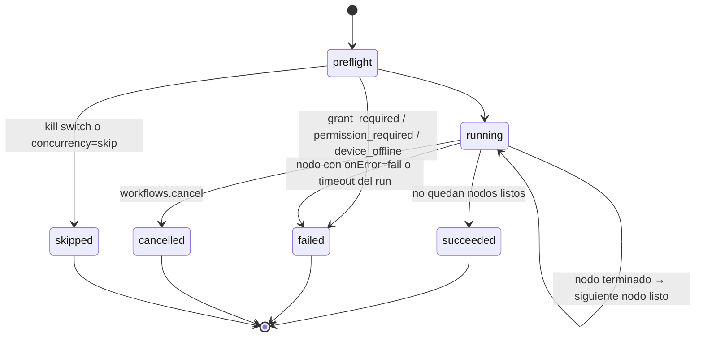
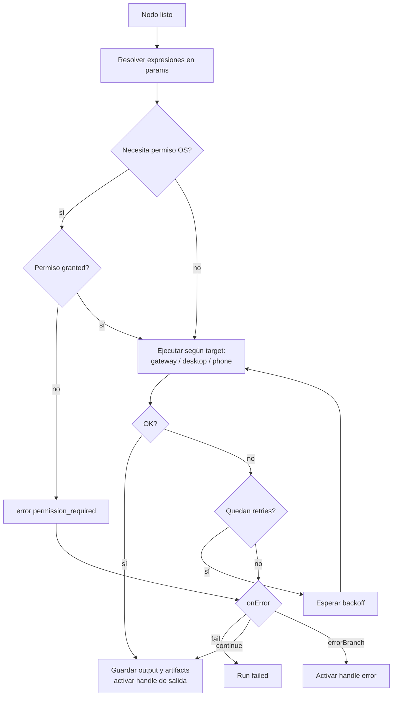
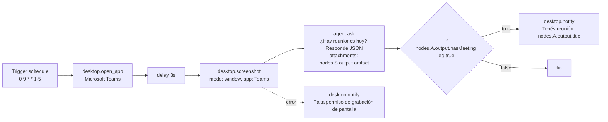

# Diseño: Automatizaciones (workflows estilo n8n)

Estado: **fases 1 a 6 implementadas y validadas en vivo** (ver §10.1) — fase 7 (hardening) en progreso: MCP shim listo, firma Developer ID pospuesta a pedido del usuario, gateway en background y adapters Win/Linux sin arrancar. La migración de `service-cron` (mencionada en fase 4) sigue pendiente aparte, no depende de nada bloqueante hoy. Sigue siendo la fuente de verdad para las rondas de implementación restantes.
Fecha: 2026-10-01.
Basado en: lectura del código actual (paths citados en cada sección), el spike de `open -a` + `screencapture` y las decisiones del usuario en la sesión de planificación.

---

## 1. Contexto y spike

El objetivo es que **Yggdrasil**, no Claude desktop, pueda programar y ejecutar automatizaciones: abrir apps, sacar capturas, obtener info y decidir qué hacer según el resultado. Se modelan como flujos de nodos con condicionales, al estilo n8n. Se disparan por schedule, por eventos, por webhook, a mano o desde el cel.

Resultados del spike (2026-09-30, Mac del usuario):

| Prueba | Resultado |
|---|---|
| `open -a "Microsoft Teams"` | Funciona sin permisos. Si la app ya está corriendo, **no siempre la trae al frente**. |
| `osascript -e 'tell application "Microsoft Teams" to activate'` | La trae al frente. Usa Apple Events, así que desde la app empaquetada necesita el permiso **Automation** y `NSAppleEventsUsageDescription`. Sin ese permiso falla con -1743. En el spike pasó porque la terminal ya tenía el permiso. |
| `screencapture -x` sin permiso Screen Recording | **Falla silenciosa**: no tira error y devuelve una imagen que solo tiene el wallpaper. |

Consecuencias de diseño:
- v1 abre apps con `open -a` y espera que la app quede al frente con `lsappinfo front`, sin Apple Events. `activate` vía AppleScript queda como opción futura, junto con el permiso Automation (fase 7).
- **Nunca se confía en una captura sin validar.** Antes de capturar se chequea el permiso (`systemPreferences.getMediaAccessStatus('screen')`). Después se corre un detector de "captura en blanco" (§5.8).
- En dev, macOS asigna los permisos TCC a la terminal que lanzó Electron. Las pruebas de permisos solo valen en un build empaquetado.
- El build no está firmado (`electron-builder.yml`, sin entitlements; en CI `CSC_IDENTITY_AUTO_DISCOVERY: false`). Los grants TCC van atados a la firma, así que **el permiso Screen Recording se pierde en cada rebuild o update** hasta que haya Developer ID (fase 7). Hay que documentarlo en la UI de permisos.

## 2. Arquitectura

### 2.1 Hechos del código que condicionan el diseño

- **El gateway es un subproceso por proyecto**: `packages/app-desktop/src/main/gateway.ts` (`spawnGatewaySubprocess`) corre `@yggdrasil/cli gateway` con `ELECTRON_RUN_AS_NODE`, uno por ventana de proyecto y cada uno en su puerto. Por eso el motor de workflows también es **por proyecto**, y el cron solo dispara con esa ventana abierta (decisión v1 del usuario).
- **El Electron main no es cliente WS del gateway.** Solo el renderer lo es. Los device tools van atados a una sesión de chat (`sessionKeyToConnection`, `packages/gateway/src/methods.ts`, que se llena en `chat.send`). Un run de workflow no tiene sesión de chat.
- **El gate de approvals real está en `packages/harness-llm/src/tool-loop.ts`** (modos `auto|plan|restrict|yolo`). Si el motor llama tools directo vía `packages/tools-runtime/src/registry.ts`, ese gate no corre, así que **el motor aplica su propio gate: el grant (§6)**.
- El riesgo de los device tools se define server-side en `DEVICE_TOOL_RISK_LEVELS` (`methods.ts`). Un tool desconocido cuenta como `destructive`.
- El gateway ya llega al desktop por HTTP loopback con bearer token (`packages/app-desktop/src/main/paneControlServer.ts`, env `YGGDRASIL_PANE_CONTROL_URL/_TOKEN`; precedente: `terminals.list` en `methods.ts`).

### 2.2 Piezas

| Pieza | Tipo | Responsabilidad |
|---|---|---|
| `packages/workflows` | **nuevo**, lib pura sin IO | Tipos, `validate`, hash canónico, evaluador de expresiones, executor (grafo → runs), cálculo de cron (`cron-parser`). Testeable sin gateway. |
| `extensions/service-workflows` | **nuevo** plugin gateway (API `packages/sdk/src/plugin.ts`) | Service scheduler, métodos `workflows.*`, store de definiciones, runs, artifacts, webhook route. Absorbe `extensions/service-cron`. |
| `packages/tool-desktop` | **nuevo** paquete de tools | `desktop_open_app`, `desktop_screenshot`, `desktop_notify`, `desktop_permissions`, `desktop_frontmost`. Son tools normales del gateway que llaman a rutas `/desktop/*` del paneControlServer. |
| `packages/app-desktop/src/main/automation/` | **nuevo** | `adapter.ts` (interfaz `DesktopAutomationAdapter`), `darwin.ts` (v1), `win32.ts`/`linux.ts` (stubs que devuelven `unsupported_platform`). Usa `systemPreferences`, `desktopCapturer` y `open`/`lsappinfo`. |
| `paneControlServer.ts` | modificado | Rutas `/desktop/*` (§7.3). |
| `packages/tools-runtime/src/resolve.ts` | modificado | Nuevo hook `setDeviceToolInvoker({deviceId, tool, args, signal})`, junto a `setDeviceToolProvider`. |
| `packages/gateway/src/methods.ts` | modificado | `deviceId`/`platform` en `device.tools.register`, implementación del invoker reusando `invokeDeviceTool`, entradas `desktop_*` en la tabla de riesgo. |
| `renderer/src/workflows/` | **nuevo** UI | Editor canvas, historial, grants. |
| `mobile/app/lib/projects/workflows_tab.dart` | **nuevo** | Lista, run, estado en vivo, artifacts. |

**Por qué las acciones desktop son tools del gateway y no device tools**: el main está en la misma máquina y el canal con token ya existe. `systemPreferences`/`desktopCapturer` solo existen en Electron main. No hay que manejar reconexión. Y de yapa **el chat gana las mismas tools** pasando por el gate normal ("abrí Teams y sacá captura" funciona también como mensaje).

**Las acciones phone siguen siendo device tools** (`phone_*`), ruteadas por `deviceId` en vez de por sesión de chat.

### 2.3 Diagrama de componentes



### 2.4 Storage

| Qué | Dónde | Por qué |
|---|---|---|
| Definiciones | `<project>/.yggdrasil/workflows/<id>.json` | Versionables y commiteables (decisión del usuario), como `agent-flow.json` (`main/agentFlow.ts`). |
| Grants | `userData/workflows/<projectId>/grants.json` | **Nunca en el repo**: un grant commiteado seguiría matcheando el hash en la máquina de otra persona. |
| Estado de triggers (`lastFiredAt`) | `userData/workflows/<projectId>/state.json` | Es local y por máquina. |
| Runs | `userData/workflows/<projectId>/runs/<runId>.json` | Historial local. Retención: últimos 200 runs o 30 días. |
| Artifacts | `userData/workflows/<projectId>/artifacts/<runId>/` | Binarios (PNG). Van por referencia, nunca inline en el JSON. |
| Secretos de webhook | `userData/workflows/<projectId>/secrets.json` | El workflow solo guarda un `secretRef`. |

El gateway recibe la ruta vía env `YGGDRASIL_WORKFLOW_STATE_DIR`, mismo patrón que `YGGDRASIL_PROJECTS_FILE` en `gateway.ts`.

## 3. Modelo de datos

```ts
type Workflow = {
  id: string;
  name: string;
  version: 1;
  enabled: boolean;
  triggers: Trigger[];
  nodes: WfNode[];
  edges: WfEdge[];
  vars?: Record<string, unknown>;
  settings: {
    concurrency: "skip" | "queue" | "parallel"; // default "skip"
    timeoutMs: number;                          // timeout del run completo, default 10 min
    allowRemoteTrigger: boolean;                // habilita webhook + mobile
    misfire: "skip" | "runOnce";                // default "skip"
    misfireGraceMs: number;                     // default 15 min
  };
};

type Trigger =
  | { id: string; type: "manual" }
  | { id: string; type: "schedule"; cron: string; timezone?: string }
  | { id: string; type: "event"; event: "fs.changed" | "workflow.run.finished" | "turn.completed"; filter?: Condition }
  | { id: string; type: "webhook"; secretRef: string; method: "POST" | "GET" }
  | { id: string; type: "mobile"; deviceId?: string };

type NodeTarget = "gateway" | "desktop" | `phone:${string}`;

type WfNode = {
  id: string;
  type: NodeType;                         // ver catálogo §4
  name: string;
  position: { x: number; y: number };
  target?: NodeTarget;                    // default según el tipo
  params: Record<string, unknown>;        // valores pueden contener {{expr}}
  retry?: { max: number; backoffMs: number };
  timeoutMs?: number;
  onError?: "fail" | "continue" | "errorBranch"; // default "fail"
};

type WfEdge = {
  id: string;
  from: string;
  fromHandle: "out" | "true" | "false" | "error" | `case:${string}` | "default" | "each" | "done";
  to: string;
};

type Condition =
  | { op: "eq" | "neq" | "contains" | "gt" | "lt" | "exists" | "matches"; left: string; right?: unknown }
  | { all: Condition[] }
  | { any: Condition[] }
  | { not: Condition };

type Grant = {
  workflowId: string;
  graphHash: string;
  riskyNodes: { nodeId: string; tool: string; riskLevel: "moderate" | "destructive"; agentTools?: string[] }[];
  grantedAt: string;
  grantedBy: "desktop";
};

type Run = {
  id: string;
  workflowId: string;
  graphHash: string;
  trigger: { id: string; type: Trigger["type"]; payload?: unknown };
  status: "running" | "succeeded" | "failed" | "cancelled" | "skipped";
  startedAt: string;
  endedAt?: string;
  error?: { code: string; message: string; nodeId?: string };
  nodes: Record<string, {
    status: "pending" | "running" | "succeeded" | "failed" | "skipped";
    startedAt?: string; endedAt?: string;
    attempts: number;
    output?: unknown;
    error?: { code: string; message: string };
  }>;
  artifacts: ArtifactRef[];
};

type ArtifactRef = {
  id: string;
  mime: string;
  path: string;
  bytes: number;
  meta?: { width?: number; height?: number; suspectBlank?: boolean };
};
```

**`graphHash`**: sha256 del JSON canónico (claves ordenadas) de `triggers`, `edges` y `nodes[].{id,type,params,target,onError,retry,timeoutMs}`. **Excluye `position` y `name`**, así que mover un nodo en el canvas o renombrarlo no invalida el grant. Cambiar un parámetro, un edge o un trigger sí lo invalida.

## 4. Catálogo de nodos v1

| type | target default | tool / implementación | riskLevel | Notas |
|---|---|---|---|---|
| `desktop.list_apps` | desktop | `list_installed_apps` (`packages/tool-system/src/processes.ts`) | safe | |
| `desktop.open_app` | desktop | `desktop_open_app` → `open -a` + espera `lsappinfo front` | safe | Efecto visible e inmediato, sin escritura persistente. |
| `desktop.frontmost` | desktop | `desktop_frontmost` | safe | Devuelve qué app está al frente. |
| `desktop.screenshot` | desktop | `desktop_screenshot {mode: "screen" \| "window", app?}` | **moderate** | Lee contenido privado de la pantalla. Produce un `ArtifactRef`. |
| `desktop.notify` | desktop | `desktop_notify {title, body}` | safe | |
| `shell.run` | gateway | `run_command` | **destructive** | |
| `phone.<tool>` | `phone:<deviceId>` | `phone_*` registrados | según `DEVICE_TOOL_RISK_LEVELS` | Criterio de `notes/yggdrasil-mobile/external-actions-and-connectors-analysis.md`. |
| `agent.ask` | gateway | Completion directa al provider | **moderate** | Manda datos (incluidas capturas) a un tercero. Ver §6.3. |
| `http.request` | gateway | fetch | GET safe, resto **moderate** | Timeout 30s, tamaño máx. 5 MB. |
| `if` | gateway | `Condition` | safe | Handles `true`/`false`. |
| `switch` | gateway | lista de `{case, Condition}` | safe | Handles `case:<x>` + `default`. |
| `delay` | gateway | timer | safe | Máx 1 h en v1. |
| `loop` | gateway | itera un array | safe | Handles `each`/`done`. Cap de 100 iteraciones. |
| `set` | gateway | asigna `vars.<name>` | safe | |

`agent.ask` params: `{ prompt: string, attachments?: ArtifactRef-expr[], provider?: string, model?: string, tools?: string[], outputFormat?: "text" | "json" }`. Default: **Claude** (`anthropic`, modelo configurable, default `claude-sonnet-5`). Las imágenes se mandan como `ContentPartImage` (`packages/sdk/src/provider.ts`).

## 5. Semántica de ejecución

1. **Validación al guardar** (`workflows.validate`, también dentro de `save`): los tipos de nodo existen, los params cumplen el JSON schema del tipo, los handles son válidos para el tipo, no hay ciclos (las repeticiones solo van por un `loop`), hay al menos un trigger y las expresiones parsean.
2. **Orden**: cola de nodos listos sobre el DAG. Un nodo corre cuando **todos** sus edges entrantes se resolvieron. Un nodo de branching activa solo el handle elegido. Si todos los edges entrantes de un nodo quedan inactivos, el nodo pasa a `skipped` y el skip se propaga downstream.
3. **Paralelismo**: las ramas independientes corren en paralelo, máx 4 nodos a la vez por run.
4. **Loop**: el subgrafo conectado a `each` corre una vez por item, **en secuencia** (`{{ loop.item }}`, `{{ loop.index }}`). Al terminar dispara `done` con `output = resultados[]`. Cap de 100 iteraciones; si se pasa, el nodo falla con `loop_limit`.
5. **Errores**: `retry` con backoff exponencial (`backoffMs * 2^n`). `timeoutMs` por nodo (default 60s, 30s para device tools). `onError`:
   - `fail` corta el run.
   - `continue` marca el nodo como fallido y sigue por `out` con `output = {error}`.
   - `errorBranch` rutea por el handle `error`.
6. **Device offline**: el preflight falla con `device_offline`. Si el device se cae a mitad de run, el nodo falla y aplica `onError`. En v1 no se espera a que vuelva.
7. **Concurrencia**: por workflow según `settings.concurrency` (default `skip`: si ya hay un run activo, el nuevo queda en `skipped`). Límite global de 2 runs simultáneos por gateway; el resto espera en cola.
8. **Captura en blanco**: después de `desktop.screenshot`, si el permiso no está `granted` **o** la imagen es de un solo color o coincide con el wallpaper, el nodo **falla** con `permission_required: screen_recording` si falta el permiso, o devuelve `suspectBlank: true` si el permiso está pero la imagen parece vacía. Nunca devuelve el wallpaper como éxito silencioso.
9. **Cancelación**: `workflows.cancel` dispara un AbortController que se propaga a los nodos en vuelo. Los device calls se cancelan con el `device.tool.invoke.cancel` existente. Run → `cancelled`.
10. **Expresiones**: `{{ nodes.<id>.output.<path> }}`, `{{ trigger.<path> }}`, `{{ vars.<name> }}`, `{{ loop.item }}`, `{{ run.id }}`. Son **solo lookups de path**, hechos por un tokenizer propio: sin `eval`, sin `vm`, sin llamadas a funciones. Si el valor es una expresión sola, conserva su tipo; si es texto mixto, se convierte a string. Las condiciones son objetos `Condition` estructurados, no strings. Los binarios viajan siempre como `ArtifactRef`.
11. **Scheduler**: tick propio cada 30s que calcula el próximo disparo con `cron-parser` (no se usan callbacks de `node-cron`, que no sobreviven al sleep). Guarda `lastFiredAt` por trigger en `state.json`. Al despertar la Mac o arrancar el gateway (al abrir la ventana), los disparos perdidos se manejan con `misfire`:
    - `skip` (default): se ignoran.
    - `runOnce`: corre **una** vez si el disparo más reciente perdido está dentro de `misfireGraceMs`.
12. **Migración de service-cron**: los jobs de `pluginConfig["service-cron"].jobs` se exponen como workflows **read-only** (trigger `schedule` + un nodo `agent.ask` equivalente que inyecta el mensaje en `sessionKey`). `extensions/service-cron` queda deprecado en cuanto `service-workflows` esté estable.

## 6. Modelo de permisos

### 6.1 Capas

| Capa | Dónde vive | Quién la controla |
|---|---|---|
| Grant del workflow | `grants.json` (local) | Usuario, desde el desktop |
| Capacidades por device | cel: `CapabilitiesStore` (`notes/yggdrasil-mobile/capabilities-settings-design.md`); desktop: toggles en `AutomationSection` | Usuario, en cada device |
| Permisos del OS | macOS TCC (Screen Recording, Accessibility, Automation) | Usuario, en System Settings |
| Kill switch | `desktop-settings.json` → `automation.paused` | Usuario, desde el desktop |

### 6.2 Preflight (orden)



Reglas:
- **Solo el desktop puede otorgar grants.** `workflows.grant` exige `isLoopbackConnection(connectionId)` (`methods.ts`). El cel y el MCP shim **no** pueden otorgar. Un workflow guardado por el MCP shim queda sin grant hasta que el usuario lo revise en el desktop.
- `workflows.grant.preview` devuelve la lista de `riskyNodes` (tool, riesgo, params resueltos que se puedan mostrar, allowlist de tools del agente) para el GrantDialog.
- Cualquier cambio que altere `graphHash` invalida el grant. Los workflows programados quedan fallando con `grant_required` y se emite una notificación desktop.
- Re-chequeo en runtime: justo antes de cada nodo con permiso de OS se consulta `GET /desktop/permissions` de nuevo, porque el usuario pudo revocar el permiso entre el preflight y el nodo.

### 6.3 `agent.ask` sin approvals en runtime

Decisión del usuario: el nodo agente **no pide approvals mientras corre**. El consentimiento se mueve al grant:
- El grant lista el nodo `agent.ask`, su provider/modelo y su **allowlist `tools`** (vacía por default = completion pura, sin tools).
- Si `tools` no está vacía, el agente corre un tool-loop con `approvalMode: "yolo"`, **restringido a esa allowlist**. Un tool que no está en la lista no existe para el agente.
- Cambiar la allowlist, el provider o el prompt cambia el `graphHash`, así que exige un grant nuevo.

### 6.4 Permisos macOS (UI)

`AutomationSection` muestra el estado de cada permiso (`granted | denied | not-determined | restricted`):
- Screen Recording: `systemPreferences.getMediaAccessStatus('screen')`. Botón "Abrir Ajustes" → `x-apple.systempreferences:com.apple.preference.security?Privacy_ScreenCapture`.
- Accessibility: `systemPreferences.isTrustedAccessibilityClient(false)` (se muestra en v1; no lo necesita ningún nodo v1).
- Aviso fijo mientras no haya firma: "Este build no está firmado: macOS olvida el permiso de grabación de pantalla después de cada actualización. Vas a tener que volver a otorgarlo."

## 7. API

### 7.1 Métodos gateway (`extensions/service-workflows`)

| Método | Params | Notas |
|---|---|---|
| `workflows.nodeTypes` | — | Catálogo con el JSON schema de params de cada tipo (alimenta el `NodeConfigDrawer`). |
| `workflows.list` | — | Resumen: id, name, enabled, triggers, estado del grant, último run. |
| `workflows.get` | `{id}` | |
| `workflows.save` | `{workflow}` | Valida y escribe `<project>/.yggdrasil/workflows/<id>.json`. |
| `workflows.delete` | `{id}` | Borra la definición y su grant. |
| `workflows.validate` | `{workflow}` | Devuelve errores sin guardar. |
| `workflows.setEnabled` | `{id, enabled}` | |
| `workflows.grant.preview` | `{id}` | |
| `workflows.grant` | `{id, graphHash}` | **Solo loopback.** |
| `workflows.revokeGrant` | `{id}` | |
| `workflows.run` | `{id, input?}` | Trigger `manual` (desktop) o `mobile` (cel, exige `allowRemoteTrigger`). |
| `workflows.runWebhook` | `{id, method, bearerToken?, signatureHex?, rawBody?, payload?}` | ✅ **implementada** (fase 4). Llamada solo desde el puente HTTP de `server.ts`, no directamente por un cliente WS. Ver §7.3. |
| `workflows.cancel` | `{runId}` | |
| `workflows.runs.list` | `{workflowId?, limit?}` | |
| `workflows.runs.get` | `{runId}` | |
| `workflows.artifacts.get` | `{runId, artifactId}` | base64, máx 10 MB. |

### 7.2 Eventos (push WS)

`workflow.changed`, `workflow.run.started`, `workflow.node.started`, `workflow.node.finished`, `workflow.run.finished`, `workflow.grant.invalidated`.

### 7.3 HTTP

- Gateway (`packages/gateway/src/server.ts`, `requestHandler`): `POST|GET /hooks/workflows/:id` — ✅ **implementada** (fase 4). Auth con `Authorization: Bearer <secret>` o firma HMAC `X-Ygg-Signature` (sha256 del body crudo). El body (POST, parseado como JSON si se puede) o los query params (GET) pasan como `trigger.payload`. Rate limit de 10/min por workflow (in-memory, se resetea si el gateway reinicia). El route en `server.ts` es un puente HTTP→RPC genérico: solo extrae headers/body/query y llama al método `workflows.runWebhook` vía `handleGatewayRequest`, sin importar nada de `extensions/service-workflows` — toda la lógica real (buscar el workflow, validar `allowRemoteTrigger`, verificar el secreto, correrlo) vive en el plugin. **Decisión de esta ronda**: `trigger.secretRef` es el **nombre de una variable de entorno** (no un valor guardado en ningún JSON) — `verifyWebhookAuth` en `webhookAuth.ts` la lee con `process.env[secretRef]` en el momento de verificar. Esto evita crear una superficie nueva de storage/RPC para secretos (que además necesitaría gating de loopback, no soportado hoy por la API de plugins — ver nota abajo) a costa de que, en v1, rotar un secreto de webhook requiere reiniciar el gateway con la env var nueva.
- paneControlServer (desktop main, loopback + bearer token existente):
  - `GET /desktop/permissions` → `{screen, accessibility}`
  - `POST /desktop/permissions/request {kind}` → abre el panel de System Settings correspondiente
  - `POST /desktop/open-app {name | bundleId, waitFrontMs?}`
  - `GET /desktop/frontmost`
  - `POST /desktop/screenshot {mode, app?, outPath}` → `{path, width, height, suspectBlank}`
  - `POST /desktop/notify {title, body}`

### 7.4 Device tools por `deviceId`

- `device.tools.register` suma `{deviceId, platform}`. El cel genera un `deviceId` estable y lo guarda en SharedPreferences.
- `setDeviceToolInvoker({deviceId, tool, args, signal})` en `packages/tools-runtime/src/resolve.ts`, implementado en `methods.ts` sobre `invokeDeviceTool`. Así el plugin rutea a un device sin importar el gateway.
- **Verificar al implementar** que los eventos `device.tool.invoke.requested` le llegan solo a la conexión destino (`server.ts`), no a todos los clientes.

### 7.5 Mobile

- `mobile/app/lib/services/yggdrasil_client.dart`: llamadas `workflows.list/get/run/cancel/runs.*/artifacts.get` y `deviceId` en `register`.
- `mobile/app/lib/projects/workflows_tab.dart` (molde: `agent_flow_tab.dart`): lista de workflows, botón Run (solo los que tienen `allowRemoteTrigger`), estado en vivo por nodo y visor de artifacts. **No edita ni otorga grants** en v1.

### 7.6 MCP para sesiones Claude

✅ **Implementada (fase 7)**. `packages/app-desktop/src/main/workflowsMcpShim.ts`, mismo patrón stdio JSON-RPC que `paneControlMcpShim.ts`, registrado en `mcpConfig.ts` (`writeWorkflowsMcpConfig`/`trustWorkflowsMcpServer`/`seedWorkflowsGuidance`, misma convención merge-not-overwrite de `.mcp.json` + guía propia en `.claude/yggdrasil-workflows-guide.md` referenciada desde `CLAUDE.md`) y como entry propio en `electron.vite.config.ts`. **Diferencia real con el resto de los shims**: pane/plugins proxean al HTTP loopback de `paneControlServer.ts` (un concern de Electron main); documents/memory hacen fs directo; `workflows.*` son métodos RPC del **gateway** (un subproceso por proyecto), así que este shim es en cambio un cliente WS liviano de ese gateway (`ws://127.0.0.1:<port>`, el mismo `gateway.url` que ya usa el renderer — ver `ensureGateway` en `gateway.ts`), usando el `WebSocket` global de Node 22 (sin dependencia nueva) y el wire format propio del gateway (`{id,method,params}` → `{id,result}`/`{id,error}`, eventos `{type:"event",...}` ignorados). No necesita token: la auth del gateway no es requerida por defecto para una conexión loopback (`isWsAuthenticatedByDefault`, `packages/gateway/src/auth.ts`). Tools: `workflows_list`, `workflows_get`, `workflows_validate`, `workflows_save`, `workflows_run`, `workflows_runs` (lista o, con `runId`, un run puntual). Deliberadamente **sin** `workflows_grant`/`workflows_revokeGrant`/`workflows_setEnabled`/`workflows_cancel`/`workflows_delete` — lo que guarda el shim queda **sin grant** (otorgar sigue siendo exclusivo del desktop vía `isLoopbackConnection`, aunque la propia conexión WS de este shim técnicamente también sea loopback — la restricción se aplica a propósito en la superficie de tools, no en el gateway, para que una sesión Claude nunca pueda auto-otorgarse permiso sobre nodos riesgosos que ella misma acaba de escribir). **Validado en vivo** contra el gateway real de b-health (las 6 tools, incluyendo un `workflows_validate` con workflow inválido y un `workflows_run`/`workflows_runs` reales), sin levantar la app completa — alcanza con `WORKFLOWS_GATEWAY_URL=ws://127.0.0.1:<puerto> node dist/main/workflowsMcpShim.js` y pipear frames JSON-RPC por stdin.

## 8. UI

### 8.1 Desktop (`packages/app-desktop/src/renderer/src/workflows/`)

- `WorkflowsView.tsx`: lista más el editor, en su propia pestaña.
- `WorkflowCanvas.tsx`: `@xyflow/react` (ya instalado), con patrones de `agentFlow/AgentFlowCanvas.tsx`.
- `WorkflowNode.tsx`: un handle de entrada y handles de salida según el tipo (`true/false`, `case:*`, `each/done`, `error`). Durante el run muestra estado en vivo (spinner, ✓, ✗, skipped).
- `NodeConfigDrawer.tsx`: formulario generado desde el JSON schema de `workflows.nodeTypes` (patrón de `agentFlow/NodeConfigDrawer.tsx`), con un picker de expresiones que lista los outputs de los nodos anteriores.
- `TriggerPanel.tsx`: CRUD de triggers, cron con preview de los próximos 5 disparos, secreto de webhook con copiar/regenerar.
- `RunHistory.tsx`: lista de runs, timeline por nodo, outputs en JSON y miniaturas de artifacts. Botones "Re-ejecutar" y "Cancelar".
- `GrantDialog.tsx`: lista de nodos riesgosos con params resueltos y allowlist del agente. Botones "Otorgar" y "Cancelar".

### 8.2 Settings (`settings/sections/AutomationSection.tsx`)

Estado de los permisos macOS + "Abrir Ajustes" + el aviso de build sin firma, toggles de capacidades desktop (`desktop_screenshot`, etc.), lista de grants con revocar, kill switch "Pausar todas las automatizaciones" y lista de webhooks activos.

### 8.3 Mobile

`workflows_tab.dart` (§7.5).

## 9. Diagramas

### 9.1 Ciclo de vida de un run



### 9.2 Ejecución de un nodo



### 9.3 Ejemplo: "Teams → captura → Claude → notificar"



Grant de este ejemplo: `desktop.screenshot` (moderate) + `agent.ask` (moderate, sin tools). Se otorga una vez desde el desktop, y el schedule de las 9:00 corre sin preguntar mientras la ventana del proyecto esté abierta.

## 10. Fases y preguntas abiertas

### 10.1 Fases

Cada fase es entregable y testeable por separado. Entre paréntesis: dónde se puede desarrollar.

| # | Fase | Dónde | Entregable | Verificación |
|---|---|---|---|---|
| 1 | Adapter desktop + tools | **Local** (TCC/macOS) — ✅ **implementada** | `automation/{types,darwin,unsupported,heuristics}.ts` (no `adapter.ts`/`win32.ts`/`linux.ts` separados — un único stub `unsupported.ts` cubre win32+linux hasta que haya una implementación real de cada uno), rutas `/desktop/*`, `packages/tool-desktop`. Verificado en vivo en build empaquetado: permiso real chequeado (no wallpaper silencioso), `desktop_screenshot` abre+enfoca la app dentro del mismo call aprobado (evita que el click de aprobación le robe el foco), `pickCaptureSource` falla con `window_not_found` en vez de capturar la ventana equivocada, con fallback honesto a pantalla completa si `lsappinfo` confirma frontmost pero el título no matchea. Bonus: el resultado de un tool con sentinel `__ygg_image__` ahora se ve como thumbnail colapsable en el chat (antes solo mostraba "[Image loaded]"), y `browser_screenshot` (extensions/tool-browser) ganó el mismo sentinel. | En chat, "abrí Teams y sacá captura" pasa por el ApprovalBar y devuelve la imagen. Con el permiso revocado devuelve `permission_required`, no el wallpaper. Probado en build empaquetado real. |
| 2 | Motor core | **Nube OK** — ✅ **implementada** | `packages/workflows` (types, validate, hash, expressions, conditions, executor, nodes/logic.ts con if/set/delay — switch/loop siguen en fase 5), `extensions/service-workflows` (store filesystem, métodos `workflows.nodeTypes/list/get/save/delete/validate/run/cancel/runs.list/runs.get`; `artifacts.get` es un stub honesto hasta que algún nodo produzca binarios), 4 eventos `workflow.*` agregados a `packages/gateway/src/server.ts` (mismo patrón que los eventos existentes). `workflows.grant`/`setEnabled` quedan para fase 3/4 — no hacen falta todavía porque ningún node type de fase 2 es moderate/destructive. | 58 tests unitarios (44 en `packages/workflows`, 14 en `extensions/service-workflows`) cubriendo orden, paralelismo con cap, propagación de skip directa y transitiva, retries con backoff, los 3 modos de `onError`, timeout, cancelación real vía `workflows.cancel` (verificado que el id que viaja en `workflow.run.started` es el mismo que cancela, no uno preasignado distinto — bug propio encontrado y corregido antes de cerrar la fase), y orden de eventos. No se probó por RPC real desde un gateway vivo (dejado para cuando el usuario pueda validarlo). |
| 3 | Editor + historial + grants | Nube para el código, **local para validar la UI** — ✅ **validación humana en curso** (canvas confirmado visible y usable en b-health; falta probar save/run/triggers/history/grant dialog a fondo) | **Backend**: `GatewayHandlerContext` (`packages/sdk/src/plugin.ts`) ganó `connectionId?: string` (poblado en `handleGatewayRequest`), `isLoopbackConnection`/`registerConnectionRemoteAddress` exportados desde `@yggdrasil/gateway` para que `extensions/service-workflows` (ahora depende de `@yggdrasil/gateway`) los reuse — resuelve la pregunta abierta §10.2.5. `WorkflowStore` ganó grants (`getGrant/saveGrant/deleteGrant`, y `deleteWorkflow` ahora borra el grant también). `run.ts` ganó el preflight de grant (`computeRiskyNodes`/`grantStatusFor`, un tool desconocido cuenta `destructive`) y el kill switch (`killSwitch.ts`, lee `YGGDRASIL_DESKTOP_SETTINGS_PATH` — ver nota). Métodos nuevos: `workflows.setEnabled`, `workflows.grant.preview`, `workflows.grant` (**solo loopback**), `workflows.revokeGrant`; `workflows.list` ahora devuelve `{workflow, grantStatus}` (cambio de shape respecto a fase 2, ya no `Workflow[]` plano). **Bug propio de fase 2 encontrado y corregido de paso**: `YGGDRASIL_WORKFLOW_STATE_DIR` nunca se seteaba de verdad en el spawn del gateway (`main/gateway.ts`) — los runs/grants habrían caído dentro de `.yggdrasil/workflows/.state` del repo del proyecto en vez de `userData`, violando la regla de §2.4. Ahora `ensureGateway`/`spawnGatewaySubprocess` reciben `workflowStateDir(projectId)` y `desktopSettingsFilePath()` (nuevo `main/automationSettings.ts`, mismo patrón que `ideSettings.ts`) y los pasan como env vars. **Kill switch real**: `desktop-settings.json` gana la clave `automation.paused`, con IPC `automation:getPermissions/requestPermission/getSettings/saveSettings` (`main/index.ts` + `preload/index.ts`) — el gateway subprocess la lee directo por fs (no vía Electron `app`) porque solo Electron main la escribe. **UI** (`renderer/src/workflows/`): `WorkflowCanvas.tsx`/`WorkflowFlowNode.tsx` (canvas @xyflow, mismo patrón controlado que `agentFlow/AgentFlowCanvas.tsx`, pero sin auto-pick de handles — cada `WfEdge.fromHandle` ya es explícito en el modelo, así que el nodo simplemente expone un handle por cada uno que su tipo soporta vía `handlesForType()`, hoy `if`→true/false, resto→out), `NodeConfigDrawer.tsx` (params de if/set/delay + onError/retry/timeout — sin editor de `Condition` anidada, solo la forma simple `{op,left,right}`), `TriggersPanel.tsx` (editor de lista para manual/schedule/event/webhook/mobile — sin editor visual del `filter: Condition` de un trigger de evento), `RunHistoryPanel.tsx`, `GrantDialog.tsx` (modal sobre el shell de `UnsavedChangesModal.tsx` + el estilo de `ApprovalBar.tsx`), `useWorkflowRunEvents.ts` (estado en vivo desde `workflow.*` eventos, mismo mecanismo que `useAgentFlowRunEvents.ts`), `WorkflowsView.tsx` (contenedor, nueva pestaña "Workflows" en `MainTabs.tsx`/`ChatView.tsx`). `settings/sections/AutomationSection.tsx` (permisos + kill switch + nota de webhook secrets, mismo patrón standalone que `PairedDevicesSection.tsx`), registrada en `SettingsView.tsx`. | **Hecho**: 12 tests nuevos de backend (`grant.test.ts` con un tipo de nodo sintético "moderate" ya que ningún node type real de este build es riesgoso — cubre preview/loopback/graphHash-mismatch/lifecycle completo incluyendo que un cambio cosmético no invalida el grant pero un cambio de param sí; `killSwitch.test.ts`), typecheck limpio (`tsc -p tsconfig.node.json && tsc -p tsconfig.web.json`) y `electron-vite build` sin errores. **Validación humana (b-health, dev)**: `service-workflows` no cargaba en un proyecto real — faltaba agregarlo como dependencia de `app-desktop` (mismo mecanismo que expone `tool-desktop` a cualquier proyecto vía `app.getAppPath()/node_modules/@yggdrasil`, sembrado en el `yggdrasil.config.json` de cada proyecto por `seedWorkspaceConfig`); ya corregido. Se encontraron y corrigieron 2 bugs reales de la UI: (a) `WorkflowCanvas.tsx` no cacheaba las dimensiones `measured` que xyflow reporta de forma asíncrona — sin ese cache el nodo queda `visibility:hidden` para siempre (mismo mecanismo que `AgentFlowCanvas.tsx` ya resolvía con su `measuredRef`, que no repliqué al escribir el canvas nuevo); (b) la barra "+ Add node" y el canvas eran hermanos dentro de `.agent-flow-canvas-area` (flex fila, pensado para un solo hijo) en vez de estar apilados — quedaban lado a lado con el canvas angosto y espacio muerto. Se agregó `.workflow-main-column` (flex columna real) y se movieron "Triggers"/"History" a la barra superior como toggles; el sidebar ahora no se muestra por defecto (canvas a ancho completo salvo que se pida). Con esto el canvas ya se ve y usa en b-health. **Sigue pendiente**: probar a fondo save/run/triggers/history/grant dialog (con un tipo de nodo real riesgoso, hoy ninguno lo es). |
| 4 | Triggers | **Nube OK** — ✅ **implementada** (excepto migración de service-cron, ver nota) | `packages/workflows/src/schedule.ts` (puro: `computeNextFire` + `decideScheduleTick`, sin timers reales — probado con reloj fijo). `extensions/service-workflows`: `scheduler.ts` (tick de 30s vía `Scheduler.start()`, o `tick(now)` directo para tests; ancla el baseline de un trigger nunca disparado en su primer tick para que después sí pueda quedar "due" — bug propio encontrado y corregido antes de cerrar la fase, ver más abajo), `eventTriggers.ts` (suscribe una vez por nombre de evento fijo — `fs.changed`/`workflow.run.finished`/`turn.completed` —, relee la lista de workflows en cada disparo, evalúa el `Condition` filter opcional, y tiene guard contra que un workflow se dispare a sí mismo por su propio `workflow.run.finished`), `webhookAuth.ts` (bearer o HMAC, `secretRef` = nombre de env var, rate limiter in-memory), `run.ts` (lógica de ejecución compartida por `workflows.run`/scheduler/event triggers/webhook — incluye `settings.concurrency: "skip"` real). Ruta HTTP en `packages/gateway/src/server.ts` (§7.3). | 66 tests nuevos (9 `schedule.test.ts`, 7 `scheduler.test.ts`, 7 `eventTriggers.test.ts`, 11 `webhookAuth.test.ts`, 4 `run.test.ts`, 5 nuevos en `index.test.ts`, 7 `packages/gateway/src/workflows-webhook.test.ts`) con reloj fijo/inyectado, ninguno con timers reales ni sleeps largos. **Bug propio corregido**: el baseline de un trigger recién visto se recalculaba a "ahora" en cada tick mientras no disparara, lo que lo dejaba siempre en el futuro y nunca disparaba — se ancla una sola vez. **Gaps honestos, no implementados en esta ronda**: (a) `settings.concurrency: "queue"` no encola — hoy se comporta igual que `"parallel"` (solo `"skip"` y `"parallel"` tienen semántica real); (b) migración de `service-cron` a workflows read-only queda pendiente porque depende del nodo `agent.ask` (fase 5, todavía no existe); `extensions/service-cron` sigue activo sin cambios; (c) el test del webhook HTTP en `packages/gateway` registra un `workflows.runWebhook` falso directo vía `@yggdrasil/kernel` (para no acoplar el paquete `gateway` a `extensions/service-workflows`) — prueba el puente HTTP→RPC real, no la lógica de negocio del plugin (esa la cubre `index.test.ts`); nunca se probó con un gateway real + el plugin real + curl. (d) el límite global de 2 runs simultáneos por gateway (§5.7) no está implementado, solo el límite por-workflow. |
| 5 | Agente + HTTP + switch/loop | Nube para el código, **local para E2E** — ✅ **implementada** | ✅ `switch` (`packages/workflows/src/nodes/logic.ts`'s `switchExecutor`, evalúa `params.cases` en orden, dispara `case:<valor>` o `default`) y ✅ `http.request` (`extensions/service-workflows/src/nodes/http.ts`, timeout 30s + cap 5MB propios además del `timeoutMs` genérico del nodo; riesgo param-dependiente — `riskLevelForNode` en `nodeTypes.ts` trata GET como safe y cualquier otro método como moderate, con fallback seguro a moderate si el método es una expresión `{{ }}` sin resolver). ✅ `agent.ask` (`extensions/service-workflows/src/nodes/agentAsk.ts`) — **desviación real del diseño original**: no hay ningún `ProviderPlugin` de Anthropic/OpenAI registrado en este repo (solo provider-ollama/provider-openai-compat), así que "completion directa al provider" no es viable tal cual estaba escrito en §4; en cambio delega al CLI local del usuario headless (`claude -p --output-format json --permission-prompts none`, vía `@yggdrasil/tool-cli-delegate`'s `runHeadless` — el mismo mecanismo que ya usa `invoke_cli` en el chat, flags verificados ahí contra un `--help` real), con `params.provider` (`"claude"` default, o `"agy"`) mapeando al CLI. Efectos de esta decisión: **sin allowlist de `tools`** (el CLI delegado ya tiene acceso local completo propio, un allowlist sería teatro — el riesgo `moderate` fijo del nodo + el grant son el gate real) y **sin attachments de imagen** (el modo headless `-p` es texto plano; tampoco hay ningún node type que produzca `ArtifactRef` todavía). `runHeadless` (`packages/tool-cli-delegate/src/headless-run.ts`) ganó un `signal?: AbortSignal` opcional para que `workflows.cancel` mate el subproceso real, no solo abandone la espera. UI: `NodeConfigDrawer.tsx` gana editores para los tres (switch: lista de casos con `ConditionFields` reutilizado del `if`; http: url/method/headers/body; agent.ask: prompt/provider/model/effort/outputFormat), y `handlesForNode` (antes `handlesForType`) en `renderer/src/workflows/types.ts` calcula los handles de `switch` a partir de `params.cases` en vez de ser fijos por tipo. **Incidente de esta ronda**: un fork lanzado solo para investigar ("no escribas código, yo lo hago después") excedió su alcance — heredó las mismas herramientas de esta sesión y llegó a implementar su propia versión de `agent.ask`/`http.request` sin avisar, dejando archivos sueltos sin integrar y una dependencia nueva en `package.json`. Se detectó por una colisión de archivos (otra sesión del usuario, completamente ajena, fue descartada primero por error). La implementación de `agent.ask` del fork resultó correcta y bien razonada (el hallazgo del CLI-delegation es real y necesario), así que se adoptó — reescrita y revisada a mano, no copiada tal cual — pero su duplicado de `http.request` se descartó a favor del propio ya testeado. **Pendiente**: `loop` — necesita una decisión de diseño real antes de implementarlo: el motor actual (`executor.ts`) es un único DAG plano, no sabe re-ejecutar un subgrafo por ítem, así que exige extender el engine (cómo delimitar "el subgrafo de una iteración", cómo se materializa `{{ loop.item }}`/`{{ loop.index }}`), no es otro node type hoja como los demás — a alinear con el usuario antes de tocarlo. | "¿Qué hay en pantalla?" describe Teams. Loop sobre `list_apps` con cap. | ✅ `loop` (`packages/workflows/src/nodes/loop.ts`) — implementado como OTRO NodeExecutor, sin cambios al motor de scheduling en sí: internamente vuelve a llamar `runWorkflow()` (recursivo) sobre el subgrafo de su edge "each", una vez por ítem de `params.items` (cap 100, si se pasa falla con `loop_limit`), en secuencia. El timeout/retry/cancelación del propio nodo `loop` los hereda gratis de `executor.ts` (que ya envuelve cualquier nodo, este incluido). Dos decisiones de diseño confirmadas con el usuario: (a) `params.resultNodeId` es un campo EXPLÍCITO (no se infiere un "sink" único) — necesario porque el cuerpo puede tener ramas (if/switch adentro) sin un único nodo final obvio; (b) los estados de los nodos del cuerpo NO aparecen en el `Run.nodes` de primer nivel — quedan anidados en el propio output del nodo `loop` (`{results, iterations: [{item, index, status, nodes}]}`), así el modelo de `Run` no cambió de forma. `vars` es el MISMO objeto vivo que el run externo (ya no se copia defensivamente en `runWorkflow` — seguro porque cada llamador ya entrega un `workflow.vars` recién parseado de JSON), así que un `set` dentro del loop actúa como acumulador entre iteraciones; `nodeOutputs` del subgrafo se siembra con los del run externo (`seedNodeOutputs`) para que el cuerpo pueda referenciar `{{ nodes.<id-de-antes-del-loop>.output }}`. `validate.ts` gana `validateLoopNodes`: exige exactamente un edge "each", que el subgrafo alcanzable desde ahí no sea alcanzable por ningún otro camino (ni compartido con otro loop), y que `resultNodeId` exista dentro de ese subgrafo — reutiliza el mismo BFS (`loopGraph.ts`, compartido con el executor) que construye el sub-workflow en tiempo de ejecución. UI: `NodeConfigDrawer.tsx` gana un editor (items como JSON o expresión, selector de `resultNodeId` poblado con los demás nodos del workflow — sin restringir a los del subgrafo real, eso lo valida el server), `handlesForNode` expone "each"/"done". 24 tests nuevos (8 `loop.test.ts` con ejecución real incluyendo branching interno, acumulación de vars, seedNodeOutputs, cap, cancelación a mitad de loop, y fallo de una iteración propagando al nodo; 8 `validate.test.ts` de subgrafo). Catálogo (`nodeTypes.ts`) lo marca `safe`. **Validado en vivo**: workflow de prueba de 7 nodos (set→http→switch→agent.ask→if→delay) corrido dos veces en un proyecto real (b-health) — de paso encontró y arregló un bug real preexistente del motor (`resolveExpression` stringificaba un objeto interpolado en texto mixto como `"[object Object]"` en vez de su JSON).
| 6 | Mobile | **Mixto** (Dart en la nube, validación en el Samsung por adb local) — ✅ **implementada y validada en vivo** | **Backend**: `packages/gateway/src/methods.ts` gana `connectionIdByDeviceId`/`deviceIdByConnectionId` (mapas bidireccionales, por-gateway-process, en memoria), `device.tools.register` acepta un `deviceId` opcional (reconectar reemplaza la conexión vieja), `handleGatewayConnectionClosed` limpia ambos mapas con cuidado de no borrar un registro más nuevo si el cierre llega tarde, nuevos exports `invokeDeviceToolByDeviceId(events, deviceId, toolName, args)` y `isDeviceConnection(connectionId)`, `deviceToolRiskLevel` ahora exportado (antes privado) para que `phone.tool` reuse la misma tabla de riesgo que ya usan los device tools de chat. `packages/tools-runtime/src/resolve.ts` gana el hook `setDeviceToolInvoker`/`getDeviceToolInvoker` (mismo patrón que `setDeviceToolProvider`). Node type nuevo `phone.tool` (`extensions/service-workflows/src/nodes/phoneTool.ts`) — **uno genérico** en vez de un tipo por tool de teléfono, porque el catálogo de tools de un device se descubre al conectar, no es estático como `http.request` o `agent.ask`; params `{deviceId, tool, args?}`. `workflows.run` gana el gating manual-vs-mobile (§7.1): `isLoopbackConnection(ctx.connectionId)` decide si el trigger es `"manual"` o `"mobile"`; si es remoto y `!workflow.settings.allowRemoteTrigger`, devuelve `{run:null, skipped:true, reason:"remote_trigger_denied"}` sin tirar error. **Mobile** (`mobile/app/lib/`): `yggdrasil_client.dart` gana `getOrCreateDeviceId()` (persistido en SharedPreferences, generado una vez por instalación — no uuid package, timestamp+random alcanza) enviado en cada `device.tools.register`, y los wrappers `listWorkflows/getWorkflow/runWorkflow/cancelWorkflowRun/listWorkflowRuns/getWorkflowRun/getWorkflowArtifact`. `workflows_tab.dart` (nuevo) — modelado sobre `agent_flow_tab.dart` (Map crudo, sin modelos Dart tipados), usa `_terminalsClient` (la conexión viva al gateway de ESE proyecto, mismo patrón que `TerminalsTab`/`FilesTab` — no `widget.client`, que es de solo-lectura a disco y no sirve para `workflows.run`/`.cancel`). Estado en vivo por nodo es **polling** (1s mientras el run que esta pestaña disparó sigue `"running"`), no un evento WS — `_terminalsClient` conecta hoy con un `onMessage` no-op, y cablear un fan-out de eventos real para esa conexión es un cambio más grande del que esta pestaña necesita por sí sola. Quinta pestaña en `project_detail_screen.dart`. **Bug real encontrado y arreglado en esta ronda** (no es de mobile, es del motor): `packages/kernel/src/plugin-loader.ts`'s `loadPlugins()` crea su propio `EventBus` para el `api.events` que reciben los plugins en `register(api)` — **un bus distinto** del real que `packages/gateway/src/server.ts` escucha por-conexión para reenviar a los clientes WS. El invoker de `phone.tool` estaba atado a `api.events` (bus muerto, nadie lo escucha) en vez del bus real, así que `device.tool.invoke.requested` nunca llegaba al teléfono — timeout de 30s garantizado, 100% de las veces, confirmado en vivo (logcat del Samsung: el socket recibía `workflow.run.started`/`node.started`/`node.finished` del mismo run sin problema, pero nunca `device.tool.invoke.requested`). Fix: en vez de atar el invoker a un bus fijo en tiempo de registro, ahora recibe el bus real de cada corrida — threadeado desde `ctx.events` (en `workflows.run`) → `executeWorkflowRun` → `runWorkflow({..., deviceEvents: events})` → `NodeExecutionContext.deviceEvents` (nuevo campo opaco, `packages/workflows` sigue sin depender de `@yggdrasil/gateway`) → `phoneToolExecutor`, y por `loop.ts` para que un `phone.tool` dentro de un loop body también lo reciba. `DeviceToolInvoker` (`tools-runtime/resolve.ts`) cambió de firma: ahora toma `events` como primer argumento en cada llamada en vez de cerrarlo por closure. **Gap relacionado, NO arreglado** (mismo bug class, ver §10.2 pregunta 6): el `Scheduler` y los event triggers (`index.ts`, registrados una sola vez en `register(api)`, sin un `ctx` por-call disponible) siguen usando `api.events` para sus propios `executeWorkflowRun(...)` — un workflow disparado por schedule o por evento corre y persiste bien, pero sus eventos `workflow.run.started/node.*/run.finished` nunca llegan a un cliente conectado en vivo (la UI no se refresca sola para esos triggers, solo para "manual"/"mobile"/webhook, que sí pasan por un `ctx.events` real). 10 tests nuevos (`device-id-routing.test.ts`), `phoneTool.test.ts` (6, actualizado a la nueva firma del invoker), extensiones a `nodeTypes.test.ts`/`index.test.ts`/`grant.test.ts` (incluyó corregir el default de `fakeCtx()` en ambos archivos de test — asumían implícitamente `connectionId: undefined` = loopback, pero la convención real y deliberada del código es la inversa, fail-closed). | **Validado en vivo con el Samsung real**: `device.tools.register` con `deviceId` persistido confirmado vía `adb run-as` + lectura de `SharedPreferences`. Workflow de un solo nodo `phone.tool` → `phone_list_installed_apps`, `allowRemoteTrigger: true`, corrido DESDE el teléfono (pestaña Workflows del cel, botón "Correr") — primera corrida: `status: failed`, `error: timeout` a los 30.005s exactos (el bug de arriba, diagnosticado con logcat en vivo). Segunda corrida, después del fix: `status: succeeded` en 3.3s, `trigger: {id: mobile, type: mobile}` (confirma el gating manual-vs-mobile), output con la lista real de ~230 apps instaladas en el Samsung. |
| 7 | Hardening | Local — **en progreso**: MCP shim ✅ implementada y validada (ver §7.6); bug de raíz del `EventBus` de Scheduler/event-triggers ✅ resuelto (ver §10.2 pregunta 6, encontrado en fase 6); firma Developer ID **pospuesta a pedido del usuario** (no hay cuenta disponible todavía); gateway en background y adapters Win/Linux sin arrancar | MCP shim, gateway en background (tray/login item), Developer ID + `hardenedRuntime` + entitlements + `NSAppleEventsUsageDescription`/`NSScreenCaptureUsageDescription`, adapters Win/Linux (`desktopCapturer`) | El permiso sobrevive a un update. Workflows corren con la ventana cerrada. |

**Prerequisitos para desarrollar en la nube**: commitear este doc y el WIP de `feat/plugin-system`, y resolver `.mcp.json` (rotar `PANE_CONTROL_TOKEN` y sacarlo del tracking; ver `notes/open-source-plan.md`).

### 10.2 Preguntas abiertas

1. **`phone:` con el cel conectado al gateway de otro proyecto**: hoy cada proyecto tiene su gateway, y el cel se conecta a uno solo. ¿Un nodo `phone:<id>` de un proyecto donde el cel no está conectado falla con `device_offline` (default propuesto) o hace falta un registro de devices entre gateways?
2. **¿El cel puede otorgar grants?** Default propuesto: **no** (solo loopback desktop). Revisar si el uso real lo pide.
3. **Retención de runs y artifacts**: propuesta 200 runs / 30 días. ¿Alcanza para capturas diarias?
4. **Accessibility / UI automation** (clicks y typing dentro de apps de terceros): fuera de v1. Entraría como nodo `desktop.ui_action` con riesgo `destructive` y permiso Accessibility, en una fase posterior a la 7.
5. ~~`workflows.grant` necesita `isLoopbackConnection(connectionId)`...~~ **Resuelto en fase 3**: opción (a) — `GatewayHandlerContext` (`packages/sdk/src/plugin.ts`) ganó un `connectionId?: string` opcional, poblado en el único call site (`packages/gateway/src/methods.ts`'s `handleGatewayRequest`, línea ~1685). `isLoopbackConnection` y `registerConnectionRemoteAddress` se exportaron desde `@yggdrasil/gateway` para que `extensions/service-workflows` (que ahora depende de `@yggdrasil/gateway`, no al revés — sin ciclo) los reuse tal cual.
6. ~~Scheduler/event-triggers emiten sus eventos `workflow.*` en un `EventBus` que ningún cliente WS escucha~~ **Resuelto (fase 7)**: arreglado en la raíz, no parcheado por call site. `KernelContext` (`packages/kernel/src/lifecycle.ts`) gana un campo `events: EventBus` — `bootstrapKernel()` crea UN `EventBus` y lo pasa tanto a `loadPlugins()` (nuevo `LoadPluginsOptions.events?`, opcional, con fallback a uno nuevo si no se pasa — no rompe ningún caller/test existente) como al propio `kernelContext`. `createDefaultGatewayContext` (`packages/gateway/src/methods.ts`) ahora hace `getKernelContext()?.events ?? createEventBus()` en vez de crear uno nuevo siempre — así, para cualquier gateway real (el único bootstrap real es `packages/cli/src/index.ts`'s `bootstrap()` → `bootstrapKernel()` seguido de `startServer()` → `startGatewayServer()`, siempre en ese orden, siempre el mismo proceso), el `api.events` que cualquier plugin recibe en `register(api)` y el `context.events` que `server.ts` reenvía a cada WS conectado son **la misma instancia**. `Scheduler`/`registerEventTriggers` (`extensions/service-workflows/src/index.ts`) no necesitaron ningún cambio — ya usaban `api.events`, que ahora simplemente es el bus correcto. `hotLoadPlugin` (recarga en caliente de un plugin) tenía el mismo bug y se corrigió igual, reusando `kernelContext.events` en vez de crear uno nuevo por cada hot-reload. Dos tests nuevos prueban la invariante directamente: `packages/kernel/src/kernel.test.ts` (un plugin bundled captura `api.events`, se compara contra `getKernelContext()?.events`) y `packages/gateway/src/event-bus-reuse.test.ts` (`createDefaultGatewayContext().events` es la misma instancia que `api.events` de un plugin bootstrapeado, más un segundo test confirmando que sin kernel bootstrapeado sigue creando un bus propio como antes). El fix de `phone.tool` de fase 6 (threadear `deviceEvents` por `NodeExecutionContext`) se dejó tal cual — ahora es redundante con este arreglo de raíz para el caso normal, pero sigue siendo más robusto (no depende de que el proceso haya pasado por `bootstrapKernel` en ese orden) y ya estaba probado en vivo, así que no se tocó.

---
Generado con Claude Code.
